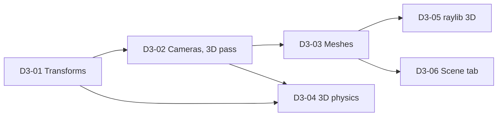

# 3D: design and plan

The engine is made for every kind of game, 2D today and 3D next. This page records how 3D joins the engine without
changing what a 2D game is, and the tasks that bring it, in order. Decided with the team on 2026-11-14.

## Decisions

| Question | Decision |
|---|---|
| How does a game say it is 2D or 3D? | It does not: **an entity is 2D or 3D by its components**. A game can mix them: a 3D world with a HUD (the UI) and 2D sprites over it, or a 2D game with one 3D object. No global mode. |
| One transform for both, or two families? | **Two families**, as Godot's 2D and 3D nodes: `aylo.Transform2D` and `aylo.Transform3D`, each with its own world pose, conventions and propagation. |
| Their names | **Renamed for symmetry**: `aylo.Transform` becomes `aylo.Transform2D`, `aylo.GlobalTransform` becomes `aylo.GlobalTransform2D`, `aylo.Camera` becomes `aylo.Camera2D`. Games of this repository are migrated in the same change. |
| The UI | Unchanged: it never used a transform. Its nodes (`aylo.UiNode`, `aylo.UiComputed`) are laid out in view pixels and drawn last, over both worlds. |
| How both worlds are drawn | **One camera per world**: `aylo.Camera2D` for the 2D world, `aylo.Camera3D` for the 3D world. A frame draws the 3D world (with a depth buffer), then the 2D world over it, then the UI. |
| Rotation in scripts | A 3D rotation is a quaternion; scripts get **Luau helpers** (`engine.math.quat`) to build and use one from angles, an axis or a target. |
| 3D physics | Same plugin and Jolt world: `aylo.Collider3D`, `aylo.Velocity3D`, a shared `aylo.RigidBody`. 2D bodies stay on their plane, 3D bodies move freely, and the two families never touch each other. |
| Renderers that cannot draw 3D | The renderer contract tells (`supports3D()`); the 3D world is not drawn by one that cannot. Vulkan and raylib (D3-05) draw it. |
| Editor | A **Scene** tab next to the Game tab, with a camera of its own to look at and edit the world, after Unity's Scene view (D3-06). |

## Conventions

| | 2D | 3D |
|---|---|---|
| Axes | X right, **Y down** (screen) | **right-handed, Y up**, the camera looks along **-Z**, as glTF |
| Units | world units (a pixel at zoom 1) | world units, read as **metres** (gravity 9.81) |
| Rotation | an angle in radians, clockwise on screen | a unit **quaternion** `{x, y, z, w}`; angles in radians |
| Scale | `vec2` | `vec3` |
| Draw order | `layer`, then the order rules of the sprites | the depth buffer; transparent things later (not in this plan) |

## Components

| Component | Fields | Plugin, task |
|---|---|---|
| `aylo.Transform2D` | `position` vec2, `rotation` f32, `scale` vec2 | transform (renamed, D3-01) |
| `aylo.GlobalTransform2D` | the same, in world space | transform (renamed, D3-01) |
| `aylo.Transform3D` | `position` vec3, `rotation` vec4 (quaternion), `scale` vec3 | transform, D3-01 |
| `aylo.GlobalTransform3D` | the same, in world space | transform, D3-01 |
| `aylo.TransformInterpolation` | none (for scripts) | transform: smooths whichever family the entity has, D3-01 |
| `aylo.Camera2D` | `priority` (and the projection's zoom) | graphics (renamed, D3-02) |
| `aylo.Camera3D` | `projection` (`"perspective"`, `"orthographic"`), `fieldOfView` (degrees), `orthographicHeight`, `near`, `far`, `priority` | graphics, D3-02 |
| `aylo.Lines3D`... | debug lines in the 3D world | graphics, D3-02 |
| `aylo.MeshRenderer` | `mesh` asset id, `color` vec4 | mesh (new plugin), D3-03 |
| `aylo.Collider3D` | `shape` (`"box"`, `"sphere"`, `"capsule"`), `size` vec3, `radius`, `halfHeight`, `offset` vec3, `sensor`, `friction`, `restitution`, `layer`, `mask` | physics, D3-04 |
| `aylo.Velocity3D` | `linear` vec3, `angular` vec3 | physics, D3-04 |

**Hierarchy.** `aylo.Parent` and `aylo.Children` stay one ECS hierarchy. Each family propagates its own poses: a 3D
child takes its parent's 3D pose. A child whose family is not its parent's is placed as a root, its parent's pose
ignored, so a 2D label can hang under a 3D entity in the hierarchy without inheriting a meaning it cannot have.

**Network.** `aylo.Transform3D` replicates as `aylo.Transform2D` does (40 bytes instead of 20; quantization later).

## Rendering

The renderer contract gains a 3D view and 3D draws, all optional (a 2D renderer keeps working):

- `supports3D()`: whether the renderer draws the 3D world. The graphics plugin skips every 3D draw otherwise, with one
  warning.
- `setView3D(const View3D&)`: position, rotation and projection (`Perspective{fovY, near, far}` or
  `Orthographic3D{height, near, far}`) of the 3D camera of the frame.
- `drawLines3D(const Lines3D&)`: lines in the world, for grids, gizmos and the physics debug view (D3-02).
- Static meshes (D3-03): `createStaticMesh(const StaticMeshDesc&)` uploads positions, normals, UVs, indices and a base
  colour texture; `destroy(StaticMeshId)`; `draw(const StaticMeshDraw&)` draws one with a world matrix and a colour.
  The name keeps them apart from `Mesh`, the triangles a tool draws over the frame.
- The frame: the 3D pass with a depth buffer, then the 2D world, then the overlay (UI), then the tools' meshes. The
  scene target and the preview (`ScenePreview`, used by the editor) get the 3D pass too.

## Meshes

glTF 2.0 (`.gltf` with its files, or `.glb`) is read by **cgltf**, private to a new `aylo.Mesh` plugin. A script loads
one with the setup form `engine.assets.mesh(path)` and draws it with `aylo.MeshRenderer`. The first version is unlit:
each primitive is drawn with its base colour factor and base colour texture; the nodes of the file are flattened into
one mesh, their transforms baked in. Lighting, materials, skins and animations come later.

## Physics

Jolt is already the engine (2D bodies are Jolt bodies held in the XY plane). 3D bodies use `EAllowedDOFs::All` and
3D shapes (box, sphere, capsule). A body is 2D or 3D by its collider (`aylo.Collider` or `aylo.Collider3D`) and reads
its family's transform and velocity. `physics.gravity3D` (default `{ 0, -9.81, 0 }`) is the 3D gravity;
`physics.gravity` stays the 2D one. 2D and 3D bodies are on separate broad phase layers, so they never collide.
Events (`aylo.CollisionStarted`, which gains `point3D` and `normal3D`) and layers stay the same;
`aylo.physics.raycast3D` casts a ray in 3D. The debug view draws 3D shapes with `Lines3D`. Jolt's gravity stays the 2D
one: the world pushes the 3D bodies with theirs. A 3D body is placed by its own `Transform3D` (no hierarchy of 3D bodies
yet), and `shapeCast`, `overlap` and `moveAndSlide` stay 2D. Details in `docs/physics/design.md` (3D bodies).

## Editor: the Scene tab

A **Scene** panel next to **Game**: Game shows what the game's camera sees, Scene shows the world from an editor
camera that is not an entity, with Unity's controls:

| Input | Scene view |
|---|---|
| Right mouse held + WASD, Q/E | fly (Shift: faster); the mouse turns the camera |
| Middle mouse drag | pan |
| Alt + left drag | orbit around the pivot |
| Wheel | move toward the pivot (zoom in 2D) |
| F | frame the selected entity |
| Left click | select the entity under the pointer |
| W, E, R | move, rotate, scale tool; the gizmo of the tool on the selection |
| 2D / 3D button | the 2D world from above (pan, zoom) or the 3D world |

It draws through the renderer's preview (a second view into a texture, which gains a 3D view and lines of its own), a grid with `Lines3D`, and the gizmos over it with ImGui. Details in `docs/Editor.md` (The Scene panel).

## Tasks

Each task is one pull request, stacked in this order (`D3-01` at the bottom); the epic is #42.

| Id | Task | Blocked by |
|---|---|---|
| D3-01 (#43) | `Transform2D` (renamed) and `Transform3D`, their world poses, propagation, interpolation, replication, rotation helpers for scripts, capsules, manual | |
| D3-02 (#44) | `Camera2D` (renamed) and `Camera3D`; `supports3D`, `View3D`, `Lines3D` in the contract; the Vulkan 3D pass with a depth buffer | D3-01 |
| D3-03 (#45) | glTF meshes: the `aylo.Mesh` plugin, `engine.assets.mesh`, `aylo.MeshRenderer`, static meshes in the contract and in Vulkan, unlit | D3-02 |
| D3-04 (#46) | 3D physics: `Collider3D`, `Velocity3D`, 3D bodies in Jolt, `gravity3D`, `raycast3D`, 3D debug view | D3-01, D3-02 |
| D3-05 (#47) | raylib draws the 3D world: `supports3D`, `View3D`, `Lines3D` and static meshes | D3-03 |
| D3-06 (#48) | The editor's Scene tab: editor camera, selection, move, rotate and scale gizmos, 2D and 3D | D3-03 |

## Not in this plan

Lighting and materials, shadows, skeletal animation, transparency sorting in 3D, 3D audio panning beyond what the
listener's position gives, sprites placed in the 3D world (billboards), level of detail, instancing.
