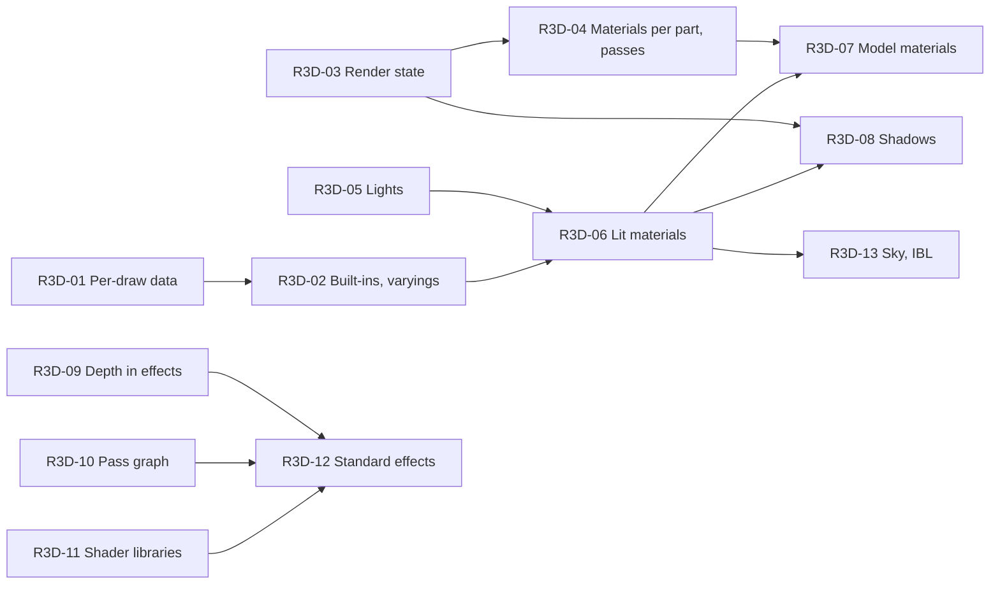

# 3D rendering: lights, shadows, lit materials and post-processing

The 3D world is drawn unlit today: a static mesh is its texture times its colours (`docs/3d/design.md`), and a
`#pragma mesh` shader can only change that colour from `VERTEX`, `NORMAL`, `UV`, `COLOR`, `TEXTURE` and `TIME`
(`docs/materials/plan.md`). A screen effect reads one image, the output of the effect before it. This plan gives the 3D
world what a general-purpose engine is expected to offer, in the order a game needs it: the data a 3D shader needs to
compute anything in space, the render state of a material, lights, lit materials, shadows, and screen effects that can
read depth and chain several passes. It follows the 3D plan (epic #42) and the materials plan (epic #56), and supersedes the 3D tickets of the renderer
Aylo was forked from (`Charles-Mahoudeau/rtype` #62, #63, #66 and the screen-effect side of #57).

Every task is general: none is shaped after one look. A toon shader, a painterly one, a realistic PBR scene, an
outline, a fog or a bloom all have to be writable with what this plan gives, without engine code of their own.

## Decisions

| Question | Decision |
|---|---|
| Lit by default? | A `#pragma mesh` shader stays unlit unless it asks for light (`#pragma lit`); the built-in material of a model becomes lit once lights exist. A scene without lights keeps today's look: the built-in lit material falls back to unlit when no light is set |
| How a shader takes part in lighting | As Godot's spatial shaders: `fragment()` writes surface built-ins (`ALBEDO`, `ALPHA`, `METALLIC`, `ROUGHNESS`, `SPECULAR`, `NORMAL`, `EMISSION`, `AO`); the engine lights them with its PBR model. An optional `light()` function replaces the shading of one light (toon ramps, custom falloffs) |
| Shading model | Metallic-roughness, as glTF: GGX specular with Smith visibility, Lambert diffuse, energy kept at low roughness. Area lights through linearly transformed cosines (LTC), the tables owned by the renderer |
| Light units | Physical, as glTF `KHR_lights_punctual` and Blender: watts for point, spot and area lights, lux (W/m²) for directional ones, so a scene exported from a DCC tool keeps its balance |
| Where lights live | ECS components (`aylo.Light3D`, `aylo.Environment3D`) in the graphics plugin; the renderer contract gets a frame's lights through `setLights3D()`, as it gets its view through `setView3D()` |
| Per-draw data | Moved from push constants to a per-frame storage buffer indexed by the draw, so a mesh gets `instance uniform`s, its world matrix in both stages and its bounds |
| Render state | Declared by the shader (`#pragma cull`, `#pragma blend`, `#pragma depth`), overridable by a `.material`; transparent 3D draws are sorted back to front after the opaque ones |
| Screen effects | Keep the simple list for the simple case; gain depth and camera access, and an optional pass graph (named intermediate targets, scaled sizes, reading any earlier target or the original scene) for effects that need several passes |
| Shader libraries | `#include "@aylo/<lib>.glsl"` and game includes: noise, colour, maths, written for the engine (MIT); no code copied from GPL sources (Blender's GLSL) |
| raylib | Declares what it supports, as `supports3D()` does; it keeps drawing models unlit and ignores lights, shadows and screen effects it cannot run, with one warning |

## Tasks

Each task is one pull request; the epic is #93.

| Id | Task | Blocked by |
|---|---|---|
| R3D-01 (#94) | Per-draw data of meshes in a storage buffer: `instance uniform`s and `MaterialInstance` on models, the world matrix and the model's bounds in both stages | |
| R3D-02 (#100) | 3D shader built-ins and varyings: world and local position, view direction, camera, matrices, `FRONT_FACING`, `FRAGCOORD`; user varyings between `vertex()` and `fragment()` | R3D-01 (#94) |
| R3D-03 (#95) | Render state of 3D materials: cull mode, depth test and write, blend modes, alpha cutout, depth bias; transparent draws sorted, order-independent transparency evaluated | |
| R3D-04 (#101) | Several materials per model and extra passes: a material per part, `nextPass` drawn after it on the same mesh | R3D-03 (#95) |
| R3D-05 (#96) | Lights: `aylo.Light3D` (directional, point, spot, rectangle), `aylo.Environment3D` (ambient), `setLights3D()`, the frame's light buffer | |
| R3D-06 (#102) | Lit 3D materials: the PBR model, surface built-ins, `light()`, LTC area lights, the built-in lit material | R3D-02, R3D-05 |
| R3D-07 (#103) | Model materials and vertex data: tangents, normal, metallic-roughness, emissive and occlusion maps, alpha modes, vertex colours, second UV set | R3D-04, R3D-06 |
| R3D-08 (#104) | Shadows: maps for directional (cascades), spot and point lights, soft filtering from the light's size, per-light and per-model switches | R3D-03, R3D-06 |
| R3D-09 (#97) | Screen effects read depth and the camera: `DEPTH_TEXTURE`, the camera's matrices, linear depth and position helpers, an optional normal buffer | |
| R3D-10 (#98) | Multi-pass screen effects: named intermediate targets at a scale of the screen, any earlier target or the original scene as input, the previous frame | |
| R3D-11 (#99) | Shader libraries: `#include` in the dialect; `@aylo/noise.glsl`, `@aylo/color.glsl`, `@aylo/math.glsl` | |
| R3D-12 (#105) | Standard screen effects on the pass graph: mip-chain bloom, sharpen, Kuwahara (anisotropic), chromatic aberration, film grain, FXAA, SSAO, fog | R3D-09, R3D-10, R3D-11 |
| R3D-13 (#107) | Environment: a sky (cubemap, HDR image or gradient) and image-based lighting from it | R3D-06 |

R3D-01, R3D-03, R3D-05, R3D-09, R3D-10 and R3D-11 can start at once.

## Lights (R3D-05)

`aylo.Light3D` and `aylo.Environment3D` are components of the graphics plugin (a component, not a resource, so a script
can spawn one). The Render system `aylo.graphics.lights3D`, after the 3D camera, turns the enabled lights into
`contract::renderer::Light3D` in the world's space (direction: the entity's -Z, the area's width: its X; `power` for
point, spot and area lights, `intensity` for directional ones) and calls `setLights3D()` with the ambient of the
environment with the highest priority. A game with neither calls nothing. A renderer whose `supportsLights3D()` is
false gets nothing and the plugin says so once.

Vulkan packs them (`rendering::packLights()`) into a storage buffer per frame in flight at **set 3, binding 1**, next
to the draws: only the mesh pipelines are lit, and they all have set 3, so set 0 (shared by every 2D pass and the
compute shaders) stays as it is. The buffer is the header (`ambient`, `count`) then `AyloLight`s of 80 bytes: position
and range, direction and kind, colour and intensity, the cone's cosines and the area's half size, the area's axis and
the shadow flag, the layout a clustered pass (`Charles-Mahoudeau/rtype#64`) would read. Past `kMaxLights3D` (64), the
directional lights are kept, then the nearest to the scene's camera. The editor draws each light with `Lines3D` in
the Scene tab (`editor/scene/LightGizmos`). The lights of a glTF file (`KHR_lights_punctual`) are not read: the mesh
plugin flattens a file into one mesh and spawns no node to carry them.

## Lit materials (R3D-06)

`#pragma lit` (with `#pragma mesh`) makes the assembler define `AYLO_LIT` in the fragment stage and add
`contract/renderer/shaders/lighting.glsl`: the surface built-ins (`ALBEDO`, `ALPHA`, `METALLIC`, `ROUGHNESS`,
`SPECULAR`, `EMISSION`, `AO`), the light built-ins of `light()`, and the BRDF of glTF 2.0's appendix B (GGX, height-
correlated Smith, Schlick, Lambert). `mesh.frag.glsl` fills the surface from the part before `fragment()` (a back face's
normal turned to the camera), then after it runs `ayloLightSurface()`: per light, `ayloSetLight()` gives `LIGHT_DIR`,
`LIGHT_COLOR` (W/m² facing the light: lux for a directional light, `P / 4π` over the distance squared for point and
spot lights, with glTF's range window and a smoothstep cone) and `ATTENUATION`, then either the shader's `light()`
(`AYLO_CUSTOM_LIGHT`) or the PBR model adds to `DIFFUSE_LIGHT` and `SPECULAR_LIGHT`; the ambient light is diffused by
the albedo and reflected through Karis's analytic environment BRDF, times `AO`; `EMISSION` is added. The result is
premultiplied by `ALPHA` and linear: tonemapping stays a screen effect. The built-in material has a lit variant
(`staticmesh_lit.frag`, the same ABI with `AYLO_LIT`), used in a frame where `setLights3D()` was called.

**Area lights do not use LTC yet.** The plan chose linearly transformed cosines; their two 64x64 tables are either the
published fits (Heitz et al., distributed under their own licence, which a release would have to carry as a notice)
or a fit made for the engine, a few hours of work of its own. Until then, a rectangle's diffuse light is exact (its
form factor by Lambert's edge formula, which is what LTC gives for a Lambertian lobe), and its reflection uses the
representative point (the point of the rectangle nearest the reflected ray) with a lobe widened by the light's size,
energy kept (Karis 2013): right for rough surfaces, a softer highlight than LTC on glossy ones. `light()` sees an area
light as one from its centre whose `LIGHT_COLOR * n.l` is that exact irradiance. Swapping in LTC changes no shader.

There is no multiple-scattering compensation: very rough metals are slightly darker than a reference path tracer.
The reference scene of the issue (a grid of spheres compared against another renderer) is not automated: there is no
GPU in CI to draw it.

## Transparency: sorting, not order-independent transparency (R3D-03)

Blended 3D draws are drawn after the opaque ones, sorted back to front by the centre of their box, per picture. This is
what Godot and Unity's built-in pipelines do, and it is exact for separate objects, which is most of a game's glass,
smoke and effects. It is wrong only inside one draw (a mesh whose triangles overlap themselves) and between two draws
that intersect.

Order-independent transparency was evaluated and is **not retained for now**:

- **Weighted blended OIT** (McGuire and Bavoil, 2013) needs two more targets (an RGBA16F accumulation and an R8 or
  R16F revealage) and a composite pass, and changes what a blended material looks like: its weights approximate the
  order, so colours shift with the depth range, and additive and multiply blends do not fit it. A game could not keep
  the exact result of sorting where sorting is right.
- **Per-pixel linked lists** are exact but need a storage buffer of fragments, an atomic counter and a resolve pass,
  with a memory bound per frame that a full-screen smoke blows; they also cost on tile-based GPUs (Apple, mobile).

Both stay possible later as an opt-in (`#pragma blend oit`): the parser rejects unknown blend values today, so adding
one breaks no shader. Until then, an intersecting pair is fixed by splitting a mesh, or by `#pragma depth test write`
on the denser one.

## Not in this plan

Reflection probes, global illumination, screen-space reflections, volumetrics, clustered or
deferred shading (the light list is capped; a clustered pass can replace it later without changing what a shader sees:
`Charles-Mahoudeau/rtype#64`), skinned meshes, GPU instancing and LOD (`Charles-Mahoudeau/rtype#65`), a general render
graph for every pass (`Charles-Mahoudeau/rtype#57`), a shader graph editor, lit materials on raylib.
