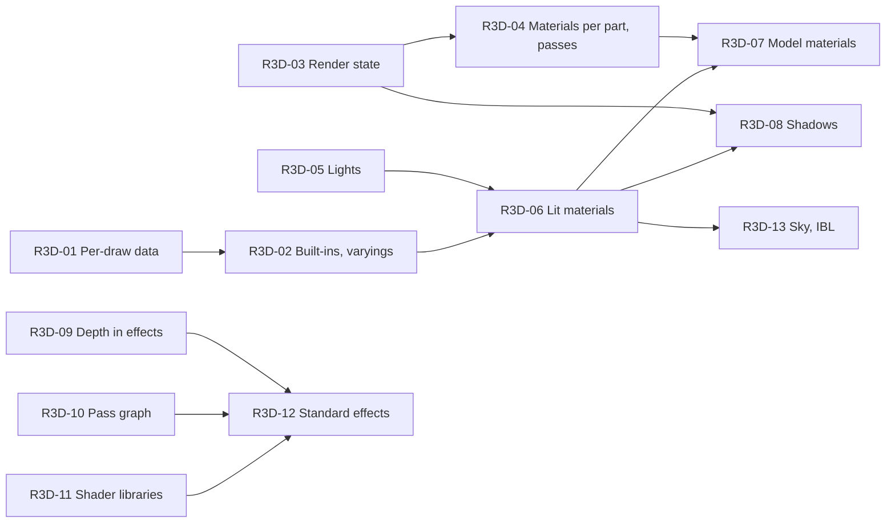

# 3D rendering: lights, shadows, lit materials and post-processing

The 3D world is drawn unlit today: a static mesh is its texture times its colours (`docs/3d/design.md`), and a
`#pragma mesh` shader can only change that colour from `VERTEX`, `NORMAL`, `UV`, `COLOR`, `TEXTURE` and `TIME`
(`docs/materials/plan.md`). A screen effect reads one image, the output of the effect before it. This plan gives the 3D
world what a general-purpose engine is expected to offer, in the order a game needs it: the data a 3D shader needs to
compute anything in space, the render state of a material, lights, lit materials, shadows, and screen effects that can
read depth and chain several passes. It follows the 3D plan (epic #42) and the materials plan (epic #56), and supersedes the 3D tickets of the renderer
Aylo was forked from (`Charles-Mahoudeau/rtype` #62, #63, #66 and the screen-effect side of #57).

Every task is general: none is shaped after one look. A toon shader, a painterly one, a realistic PBR scene, an
outline, a fog or a bloom all have to be writable with what this plan gives, without engine code of their own.

## Decisions

| Question | Decision |
|---|---|
| Lit by default? | A `#pragma mesh` shader stays unlit unless it asks for light (`#pragma lit`); the built-in material of a model becomes lit once lights exist. A scene without lights keeps today's look: the built-in lit material falls back to unlit when no light is set |
| How a shader takes part in lighting | As Godot's spatial shaders: `fragment()` writes surface built-ins (`ALBEDO`, `ALPHA`, `METALLIC`, `ROUGHNESS`, `SPECULAR`, `NORMAL`, `EMISSION`, `AO`); the engine lights them with its PBR model. An optional `light()` function replaces the shading of one light (toon ramps, custom falloffs) |
| Shading model | Metallic-roughness, as glTF: GGX specular with Smith visibility, Lambert diffuse, energy kept at low roughness. Area lights through linearly transformed cosines (LTC), the tables owned by the renderer |
| Light units | Physical, as glTF `KHR_lights_punctual` and Blender: watts for point, spot and area lights, lux (W/m²) for directional ones, so a scene exported from a DCC tool keeps its balance |
| Where lights live | ECS components (`aylo.Light3D`, `aylo.Environment3D`) in the graphics plugin; the renderer contract gets a frame's lights through `setLights3D()`, as it gets its view through `setView3D()` |
| Per-draw data | Moved from push constants to a per-frame storage buffer indexed by the draw, so a mesh gets `instance uniform`s, its world matrix in both stages and its bounds |
| Render state | Declared by the shader (`#pragma cull`, `#pragma blend`, `#pragma depth`), overridable by a `.material`; transparent 3D draws are sorted back to front after the opaque ones |
| Screen effects | Keep the simple list for the simple case; gain depth and camera access, and an optional pass graph (named intermediate targets, scaled sizes, reading any earlier target or the original scene) for effects that need several passes |
| Shader libraries | `#include "@aylo/<lib>.glsl"` and game includes: noise, colour, maths, written for the engine (MIT); no code copied from GPL sources (Blender's GLSL) |
| raylib | Declares what it supports, as `supports3D()` does; it keeps drawing models unlit and ignores lights, shadows and screen effects it cannot run, with one warning |

## Tasks

Each task is one pull request; the epic is #93.

| Id | Task | Blocked by |
|---|---|---|
| R3D-01 (#94) | Per-draw data of meshes in a storage buffer: `instance uniform`s and `MaterialInstance` on models, the world matrix and the model's bounds in both stages | |
| R3D-02 (#100) | 3D shader built-ins and varyings: world and local position, view direction, camera, matrices, `FRONT_FACING`, `FRAGCOORD`; user varyings between `vertex()` and `fragment()` | R3D-01 (#94) |
| R3D-03 (#95) | Render state of 3D materials: cull mode, depth test and write, blend modes, alpha cutout, depth bias; transparent draws sorted, order-independent transparency evaluated | |
| R3D-04 (#101) | Several materials per model and extra passes: a material per part, `nextPass` drawn after it on the same mesh | R3D-03 (#95) |
| R3D-05 (#96) | Lights: `aylo.Light3D` (directional, point, spot, rectangle), `aylo.Environment3D` (ambient), `setLights3D()`, the frame's light buffer | |
| R3D-06 (#102) | Lit 3D materials: the PBR model, surface built-ins, `light()`, LTC area lights, the built-in lit material | R3D-02, R3D-05 |
| R3D-07 (#103) | Model materials and vertex data: tangents, normal, metallic-roughness, emissive and occlusion maps, alpha modes, vertex colours, second UV set | R3D-04, R3D-06 |
| R3D-08 (#104) | Shadows: maps for directional (cascades), spot and point lights, soft filtering from the light's size, per-light and per-model switches | R3D-03, R3D-06 |
| R3D-09 (#97) | Screen effects read depth and the camera: `DEPTH_TEXTURE`, the camera's matrices, linear depth and position helpers, an optional normal buffer | |
| R3D-10 (#98) | Multi-pass screen effects: named intermediate targets at a scale of the screen, any earlier target or the original scene as input, the previous frame | |
| R3D-11 (#99) | Shader libraries: `#include` in the dialect; `@aylo/noise.glsl`, `@aylo/color.glsl`, `@aylo/math.glsl` | |
| R3D-12 (#105) | Standard screen effects on the pass graph: mip-chain bloom, sharpen, Kuwahara (anisotropic), chromatic aberration, film grain, FXAA, SSAO, fog | R3D-09, R3D-10, R3D-11 |
| R3D-13 (#107) | Environment: a sky (cubemap, HDR image or gradient) and image-based lighting from it | R3D-06 |

R3D-01, R3D-03, R3D-05, R3D-09, R3D-10 and R3D-11 can start at once.

## Lights (R3D-05)

`aylo.Light3D` and `aylo.Environment3D` are components of the graphics plugin (a component, not a resource, so a script
can spawn one). The Render system `aylo.graphics.lights3D`, after the 3D camera, turns the enabled lights into
`contract::renderer::Light3D` in the world's space (direction: the entity's -Z, the area's width: its X; `power` for
point, spot and area lights, `intensity` for directional ones) and calls `setLights3D()` with the ambient of the
environment with the highest priority. A game with neither calls nothing. A renderer whose `supportsLights3D()` is
false gets nothing and the plugin says so once.

Vulkan packs them (`rendering::packLights()`) into a storage buffer per frame in flight at **set 3, binding 1**, next
to the draws: only the mesh pipelines are lit, and they all have set 3, so set 0 (shared by every 2D pass and the
compute shaders) stays as it is. The buffer is the header (`ambient`, `count`) then `AyloLight`s of 80 bytes: position
and range, direction and kind, colour and intensity, the cone's cosines and the area's half size, the area's axis and
the shadow flag, the layout a clustered pass (`Charles-Mahoudeau/rtype#64`) would read. Past `kMaxLights3D` (64), the
directional lights are kept, then the nearest to the scene's camera. The editor draws each light with `Lines3D` in
the Scene tab (`editor/scene/LightGizmos`). The lights of a glTF file (`KHR_lights_punctual`) are not read: the mesh
plugin flattens a file into one mesh and spawns no node to carry them.

## Lit materials (R3D-06)

`#pragma lit` (with `#pragma mesh`) makes the assembler define `AYLO_LIT` in the fragment stage and add
`contract/renderer/shaders/lighting.glsl`: the surface built-ins (`ALBEDO`, `ALPHA`, `METALLIC`, `ROUGHNESS`,
`SPECULAR`, `EMISSION`, `AO`), the light built-ins of `light()`, and the BRDF of glTF 2.0's appendix B (GGX, height-
correlated Smith, Schlick, Lambert). `mesh.frag.glsl` fills the surface from the part before `fragment()` (a back face's
normal turned to the camera), then after it runs `ayloLightSurface()`: per light, `ayloSetLight()` gives `LIGHT_DIR`,
`LIGHT_COLOR` (W/m² facing the light: lux for a directional light, `P / 4π` over the distance squared for point and
spot lights, with glTF's range window and a smoothstep cone) and `ATTENUATION`, then either the shader's `light()`
(`AYLO_CUSTOM_LIGHT`) or the PBR model adds to `DIFFUSE_LIGHT` and `SPECULAR_LIGHT`; the ambient light is diffused by
the albedo and reflected through Karis's analytic environment BRDF, times `AO`; `EMISSION` is added. The result is
premultiplied by `ALPHA` and linear: tonemapping stays a screen effect. The built-in material has a lit variant
(`staticmesh_lit.frag`, the same ABI with `AYLO_LIT`), used in a frame where `setLights3D()` was called.

**Area lights do not use LTC yet.** The plan chose linearly transformed cosines; their two 64x64 tables are either the
published fits (Heitz et al., distributed under their own licence, which a release would have to carry as a notice)
or a fit made for the engine, a few hours of work of its own. Until then, a rectangle's diffuse light is exact (its
form factor by Lambert's edge formula, which is what LTC gives for a Lambertian lobe), and its reflection uses the
representative point (the point of the rectangle nearest the reflected ray) with a lobe widened by the light's size,
energy kept (Karis 2013): right for rough surfaces, a softer highlight than LTC on glossy ones. `light()` sees an area
light as one from its centre whose `LIGHT_COLOR * n.l` is that exact irradiance. Swapping in LTC changes no shader.

There is no multiple-scattering compensation: very rough metals are slightly darker than a reference path tracer.
The reference scene of the issue (a grid of spheres compared against another renderer) is not automated: there is no
GPU in CI to draw it.

## Model materials and vertex data (R3D-07)

`StaticMeshPart` carries glTF's metallic-roughness material: factors, the metallic-roughness, normal, occlusion and
emissive textures (data textures created linear, colour ones sRGB), the alpha mode and cutoff, `doubleSided`, and the
base colour's `KHR_texture_transform` applied to every map. `StaticMeshDesc` gains optional per-vertex `tangents`,
`colors` and `uv2`, each in a vertex buffer of its own (bindings 1 to 3): a mesh without one binds the pass's default
data (one buffer of tangents along X, white and zero UVs, grown for the largest mesh, its old versions kept until the
pass goes since frames in flight may read them), so a model pays only for what it has. Tangents come from the file, or
MikkTSpace (`mesh/detail/Tangents`, private) for the vertices without one, and only for a model with a normal map.

Set 1 of the static mesh layout holds a part's five textures (`MeshPartTextures`, per part and frame in flight,
rewritten when a texture changes or goes, as a material's set 2); a game mesh shader still reads only the first, as
`TEXTURE`. The push constants (`StaticMeshConstants`, 80 bytes) carry the factors, the maps the part has and its alpha
mode. The built-in pipelines are one per lighting, side and blending (8 at most, built when first used): an opaque part
ignores its alpha, a mask part is cut out at its cutoff, a blend part is blended and sorted with the others, and a part
not double sided culls its back faces. A lit shader on a model starts from the same surface. A part made in code keeps
`doubleSided` true and is opaque: an alpha below 1 on it is no longer blended. ufbx gives FBX and OBJ files the same
material values, but no tangents, vertex colours or second UVs from the file yet, and keeps both sides.

## Shadows (R3D-08)

The shadow maps are tiles of one depth atlas of `kShadowAtlasSize` (4096) texels, cut by the environment's
`shadowResolution` (2048: 4 tiles, 1024: 16, 512: 64), so no image is made again when lights come and go.
`rendering::planShadows()` (pure, tested) gives each light that casts shadows its tiles, in the order of the buffer of
lights, while they fit: a directional light one per cascade over `shadowDistance` of the scene's camera (practical
split, 0.7 logarithmic), each the bounding sphere of its slice of the frustum, its size rounded and its centre snapped
to whole texels in the light's space so the edges do not shimmer; a spot light a perspective map of its cone; an area
light one of 120° along its facing (its true shape is not used); a point light six of a little more than 90°, the faces
of a cube. The projections put Y down, as the camera's, so a cull mode keeps its meaning. `AyloLight.right.w` holds a
light's first tile + 1, the header's `count.y` the cascades; the tiles (`AyloShadowTile`: matrix, rectangle, bias,
depth range, sizes) are at set 3, binding 2, the atlas at binding 3.

The shadow pass records, before the pictures, every draw that casts shadows into each tile, with the frame's set 0
holding the tile's view: a game material with its shader's `vertex()` (`GameShader::getShadowPipeline()`, per culling)
and, when it writes `ALPHA_SCISSOR`, its `fragment()`; a model without one with the built-in vertex stage and an empty
fragment stage, or the cutout one for a glTF mask part. Blended draws, `#pragma shadow off` shaders and models with
`castShadows` off are skipped. The pass binds a set 3 of its own whose atlas binding is the fallback texture, so a
cutout lit shader does not read the image it writes. A pipeline depth bias (dynamic, scaled by the light's
`shadowBias`) and a lookup moved along the normal by `shadowNormalBias` texels keep surfaces from shadowing themselves.

`lighting.glsl` picks the tile (the cascade by the view depth, the cube face by the major axis), compares linear
depths, and filters by percentage-closer soft shadows: 16 Poisson taps find the blockers, the penumbra grows with the
gap to them times the light's size (the sun's angle, a 10 cm bulb, an area light's rectangle, times `shadowSoftness`),
and 16 taps filter it, between 1 and 12 texels. The atlas is read with `texelFetch`: MoltenVK's translation to Metal
loses a sampler handed down through several calls. A draw that does not receive shadows says so in `boundsMin.w`.

A game cutout shader's `fragment()` writes a colour in the shadow pass, which has no colour attachment: the validation
layer warns that the write is unused, which is harmless. Shadows of the preview (the editor's Scene tab) are the scene
camera's cascades.

## Depth in screen effects (R3D-09)

Screen effects get a set 3 (`_screenLayout`) holding the scene's 3D depth, and frame uniforms of their own
(`_screenGlobals`) with the 2D view-projection and the 3D camera. The effects are resolved before the scene is recorded:
when one reads depth (`CompiledShader::readsDepth`), the 3D pass stores its depth attachment and makes it readable;
otherwise nothing changes and set 3 holds the white pixel, the far plane. The issue's optional normal buffer is not
made: `normalAt()` rebuilds the normal from the depth of the nearest neighbours on each axis, which costs no
attachment, no mesh pipeline variant and nothing to a game that does not use it. The positions are computed over the
whole picture: a virtual resolution with bars offsets them.

## Screen passes (R3D-10)

The effects form a list of passes, not a free graph: a pass reads the chain, `"scene"` or a target an earlier pass
wrote, which makes the order of the list the order of execution and every error ("reads a later target") checkable
before recording. `TEXTURE` of a pass without `input` is the chain (what the passes without output left), so a branch
such as a glow's blurs does not break the effects around it; the issue's example reads the scene through
`SCENE_TEXTURE` and gets the same picture. Targets are kept between frames and not aliased (the issue's "aliased where
lifetimes allow"): a game names a handful of them and aliasing would need a lifetime analysis for little memory. The
optional `.effect` file format is left out: a script shares a chain as a Luau module.
`docs/Shaders.md` (*Screen effects*) describes the implementation.

## Shader libraries (R3D-11)

`#include` is expanded before the parser, into one text with the origin of each line, rather than handled by
glslang's own include support: the parser must see the declarations of an included file (a `uniform` in a palette
file is a material value), and the engine's error messages must name the included file. Each file is included once, as
if every file had an include guard, so two libraries may share a third. The libraries are tested on the CPU: they are
written in the part of GLSL C++ also reads, and a test runs them over glm, since the CI has no GPU. The issue asked for
a page per library with pictures; the manual has one page with a section per library and no pictures, which need a
screen capture this change could not make. `docs/Shaders.md` (*How a shader is compiled*, *Libraries*) describes them.

## Standard screen effects (R3D-12)

Every effect is a shader of `shader/builtin/` and its passes are written in Luau (`engine.effects`), which proves the
pass graph, depth and libraries enough: no effect has renderer code. The issue's `"@aylo/bloom.effect"` became a Luau
function, as R3D-10 left out the effect file format; a shader's name in the list is the effect with its defaults. The
single-pass `@aylo/bloom.glsl` is kept, since games load it by name; the mip-chain bloom has its parameters, its
`radius` choosing the number of levels (log2(radius / 2), 1 to 8). Its cost was not measured: the renderer has no GPU
timer (no timestamp queries), so the manual gives samples per pixel instead (about 6 per screen pixel at the default
radius against 64), and the issue's budget per effect at 1080p is left to a renderer that can time its passes. The
manual has one page with a section per effect, without the before and after pictures, which need a screen capture
this change could not make. SSAO is the classic hemisphere test on the depth (normals rebuilt by `normalAt()`), with a
plain blur, not a depth-aware one.

## Sky and image-based lighting (R3D-13)

`Environment3D` gains a sky (`SkyKind`: none, a gradient of three colours, or an image), its intensity, its rotation
and `lightingFromSky`; the component `aylo.Environment3D` has the same fields, its image an asset id resolved once the
texture is loaded. Textures gain `TextureEncoding::kHdr` (RGBA 32-bit floats), which the graphics plugin gives a
Radiance `.hdr` file (stb_image's `stbi_loadf`, already private to it).

The Vulkan renderer's `rendering::EnvironmentMaps` allocates nothing until a sky is set. When the sky changes (not its
intensity, applied when read), it records before the 3D pass:

1. the environment, 1024x512 half floats, from the image (four samples a texel, turned by the rotation) or the
   gradient, and its mips by blits;
2. the reflection, 512x256 with 7 mips, a mip a roughness (0, 1/6... 1), GGX importance sampling (128 samples) reading
   blurrier mips of the environment for wider lobes (Karis 2013);
3. the irradiance over pi, 64x32, integrating the 32x16 mip of the environment by solid angle and cosine.

Barriers order this after the frames that still read the last maps, so no wait. The lit meshes read the two last at
set 3, bindings 4 and 5; `packLights` puts their mips in `count.z` and the intensity in `ambient.w`. `ENV_DIFFUSE` is
`ambient + irradiance`, `ENV_SPECULAR` `ambient + reflection(R, roughness)`; the ambient term is
`AO * (diffuse albedo * ENV_DIFFUSE + environmentBrdf * ENV_SPECULAR)`, which is the old term when there is no sky.

Deviations from the issue:

- **Equirectangular 2D images, not cubemaps.** The maps stay on the 2D image and sampler path the renderer has, with a
  sampler wrapping around the horizon; the contract gains no cubemap type, and a folder of six faces is not read. A
  cubemap would sample the poles better; the maps' sizes keep the difference small.
- **No BRDF table.** The analytic fit of the split-sum's second term (`ayloEnvironmentBrdf`, Karis 2014), already used
  for the ambient light, replaces it.
- **The sky is drawn first in the 3D pass**, depth neither tested nor written, rather than at the far plane after the
  opaque models: the models cover it. It costs one fullscreen pass of overdraw, and needs no split of the mesh pass.
- **The settings form `engine.settings.environment3D` is not added**: the sky is on the `aylo.Environment3D`
  component, as the ambient light and the shadows' settings are since R3D-05.

## Transparency: sorting, not order-independent transparency (R3D-03)

Blended 3D draws are drawn after the opaque ones, sorted back to front by the centre of their box, per picture. This is
what Godot and Unity's built-in pipelines do, and it is exact for separate objects, which is most of a game's glass,
smoke and effects. It is wrong only inside one draw (a mesh whose triangles overlap themselves) and between two draws
that intersect.

Order-independent transparency was evaluated and is **not retained for now**:

- **Weighted blended OIT** (McGuire and Bavoil, 2013) needs two more targets (an RGBA16F accumulation and an R8 or
  R16F revealage) and a composite pass, and changes what a blended material looks like: its weights approximate the
  order, so colours shift with the depth range, and additive and multiply blends do not fit it. A game could not keep
  the exact result of sorting where sorting is right.
- **Per-pixel linked lists** are exact but need a storage buffer of fragments, an atomic counter and a resolve pass,
  with a memory bound per frame that a full-screen smoke blows; they also cost on tile-based GPUs (Apple, mobile).

Both stay possible later as an opt-in (`#pragma blend oit`): the parser rejects unknown blend values today, so adding
one breaks no shader. Until then, an intersecting pair is fixed by splitting a mesh, or by `#pragma depth test write`
on the denser one.

## Not in this plan

Reflection probes, global illumination, screen-space reflections, volumetrics, clustered or
deferred shading (the light list is capped; a clustered pass can replace it later without changing what a shader sees:
`Charles-Mahoudeau/rtype#64`), skinned meshes, GPU instancing and LOD (`Charles-Mahoudeau/rtype#65`), a general render
graph for every pass (`Charles-Mahoudeau/rtype#57`), a shader graph editor, lit materials on raylib.
