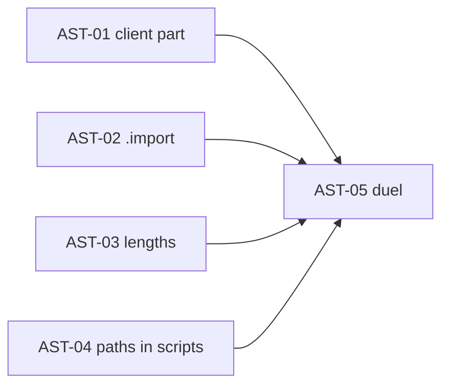

# Assets named where they are used: plan

Goal: **a game names an asset where it uses it, never in a list of its own.** In Godot or Unity a script does not load
what it shows: a scene or a prefab references its images and sounds, the editor fills those references, and opening
the scene loads them. Import options (stream this music, slice that sheet) live next to the file, in a `.import` or a
`.meta`. Loading by path in code (`load()`, `Resources.Load()`) is the exception.

AYLO Duel still has a `client/assets.luau` that loads the ships' and the laser's atlases, the music, the shots, the
menu's images and the font, only to hand their ids to the scripts. Each line is there for one of four reasons, and each
task of this plan removes one:

| Why the line is needed today | Task |
|---|---|
| An actor the server spawns brings nothing of its look to a client, so a client system dresses it, with ids | AST-01 |
| An option of the music (`stream = true`) can only be given by the script that loads it first | AST-02 |
| An interface is built in a script, as no one writes a capsule of it by hand (its lengths are `(50, 2)`) | AST-03 |
| A path a script writes (`font = "fonts/orbitron.json"`) gives the id but loads nothing | AST-04 |

AST-05 then rewrites the duel without `assets.luau`.

**A game is written without the editor too.** Every task keeps both ways open: a capsule stays a text file written by
hand ([`../CapsuleFormat.md`](../CapsuleFormat.md)), an import file is a few lines of JSON, and a script can still
spawn, load and name everything itself. The editor only fills the same files.

Based on `main` of 2026-11-28.

## 1. Decisions

| # | Decision | Why |
|---|---|---|
| D1 | **A server-spawned actor brings its client part.** `spawnCapsule()` (not `loadCapsule()`, not a nested root) gives the root a replicated `aylo.SpawnedCapsule { capsule }` (`kSpawnOnly`). On a client, the capsule plugin's system `aylo.Capsule.SpawnReplicated` (Update, client side) finds the roots with a `SpawnedCapsule` and no `CapsuleInstance`, and spawns into each the part the server could not send: the root's values the client keeps whose component is not replicated (a `SpriteRenderer`, an `AudioSource`, a `Collider` too), and the `side=client` child nodes with their subtrees. It then gives the root its `Name` and `CapsuleInstance`, so it is done once. | Unity's Netcode and Godot's `MultiplayerSpawner` instance the same prefab on every peer. The replicated components still come only from the server (a client never writes them), and a capsule the client spawns, or that both sides load, already has its `CapsuleInstance`, so it is never spawned twice. Clients never step the physics: a body follows its `Transform2D`, so a client may have the actor's colliders (the debug view shows them). |
| D2 | **What does not reach a client.** The `server` and `both` child nodes of a replicated actor come through replication only, with their replicated components; the overrides the server gave at spawn (`engine.capsule.spawn(ctx, path, { ... })`) reach a client only for replicated components; a capsule id the client does not know is reported once and skipped. A client's hot reload leaves these roots to the server. | Matching a replicated child to its node would need the node's path on the network. A game puts an actor's look on its root or in `side=client` nodes, and replicates what differs per instance. Bytes from the network never crash. |
| D3 | **Import options beside the file.** `<file>.import` (`assets/maint.ogg.import`) is a JSON object of the options a loader of that file would take: for a sound, `{ "stream": true }`. Every load of the file applies it (a setup form, a capsule, AST-04); an option a script gives wins over the file's. An unknown key is an error naming the file. | Godot's `.import`, Unity's `.meta`. The id stays the file's, so a capsule naming `maint.ogg` gets a streamed music. Other kinds (a texture's `linear`) can read the same file later. |
| D4 | **A length is written with its unit in a capsule file**, as a script writes it: `width = 120` (pixels), `width = "50%"`, `width = auto`. A field with units (`FieldUnits`, the `UiLength` of the UI) is read and written this way only. | An interface is then a capsule a person writes by hand: `engine.ui.spawn`'s tables become node sections with `aylo.UiNode`, `aylo.UiImage`, `aylo.UiText`. Enum names (`direction = row`) are read already. |
| D5 | **A path a script writes is loaded.** The bridge records each path it turns into an asset id (a component field, an engine call's argument) in the ECS resource `aylo.NamedAssets`; a PostUpdate system of the bridge hands each path it did not ask for yet to `AssetLoaders`, as `loadNamedAssets()` does for the capsules. `AssetLoaders` moves from `plugins/` to `ecs/asset/`, so the bridge sees it without knowing a plugin. A path no loader takes (a name such as `game.leftShip`) is skipped; one that fails is reported once. | Godot's `load()`. The asset loads the first frame a script names it, before drawing; a game that cannot have that hitch still loads it at start with its setup form. |

## 2. Tasks

| Id | Task | Blocked by |
|---|---|---|
| AST-01 | [Capsule] A server-spawned actor brings its client part (D1, D2) | |
| AST-02 | [Audio] Import options beside a sound file (D3) | |
| AST-03 | [Capsule] Lengths with their unit in capsule files, so an interface is a capsule (D4) | |
| AST-04 | [Scripting] Load the assets a script names by path (D5) | |
| AST-05 | [Duel] No `assets.luau`: looks in the actors, music in the arena, menu screens in capsules, paths in the scripts | AST-01, AST-02, AST-03, AST-04 |

Each task updates its design doc (`ecs/features/18-capsules.md`, `audio/design.md`, `CapsuleFormat.md`, `Ui.md`,
`ecs/features/19-luau-bridge.md`) and its manual page, and has its tests (C++ and, for what a script sees, a script
test).

## 3. What the duel looks like after

- `actors/ship_left.actor`: `game.Ship`, the body, and `aylo.SpriteRenderer` with
  `aylo.SpriteAnimator = { atlas = "atlases/ship_left.atlas", animation = "fly" }` on its root. `DressShips` and
  `DressLasers` go; `FollowShips` and `FollowLasers` stay (positions are replicated through `game.Ship` and
  `game.Laser`).
- `assets/maint.ogg.import`: `{ "stream": true }`; the music is an `aylo.AudioSource` (music bus, loop) on a client
  node of `arena.scene`.
- `ui/menu.capsule`, `ui/joining.capsule`: the menu's screens, spawned with `engine.capsule.spawn` on entering their
  state. What changes at run time (the button's image under the pointer, the reason a join failed) stays in scripts,
  which write paths.
- The shot sounds: `engine.audio.play(ctx, "laser.mp3")`.
