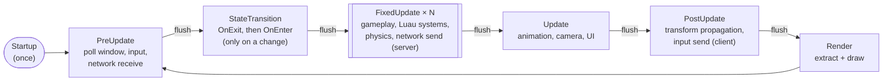
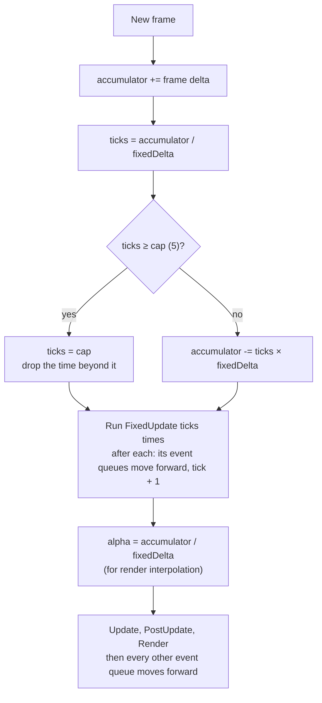
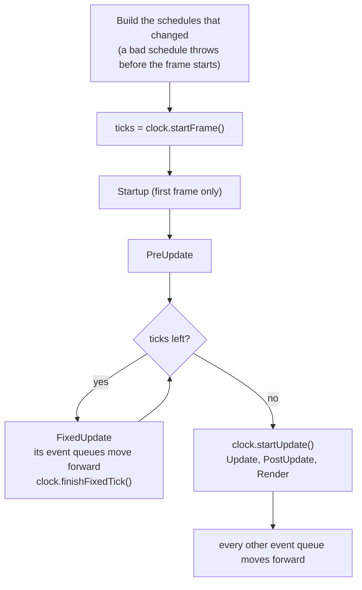
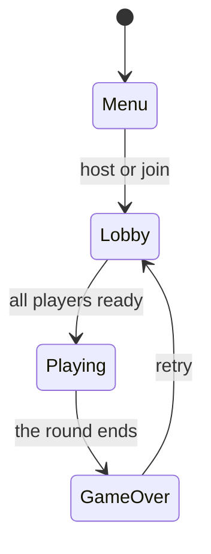

# 13 · Scheduler

## What it is

The scheduler decides **when each system runs**: in which phase of the frame, in which order inside the
phase, how many times (fixed timestep), and whether it runs at all (run conditions and game states).

## Why we need it

- **R1:** with the ECS owning the loop, the scheduler *is* the frame: poll the window, run gameplay,
  send network packets, draw.
- **R3:** the simulation must advance in **fixed ticks** (60 per second), independent of the frame rate,
  so server and clients count ticks the same way.
- **R4:** games add systems from many plugins; explicit ordering keeps that predictable.

## How others do it

| ECS | Scheduling |
|---|---|
| Bevy | Schedules (`Startup`, `PreUpdate`, `FixedUpdate`, `Update`, `PostUpdate`), system sets, `before` / `after`, run conditions, `States` with `OnEnter` / `OnExit`, automatic parallelism |
| flecs | Pipelines of phases (`OnLoad`, `PreUpdate`, `OnUpdate`, `PostUpdate`, `OnStore`), multithreading |
| Unity DOTS | System groups with `UpdateBefore` / `UpdateAfter`, fixed-step group |
| Unreal Mass | Processing phases and execution groups with ordering |

## Our choice

Bevy's model, in two steps: **phases + ordering + fixed timestep** in v1, **run conditions + States** in
v2 (both done). Sequential execution first; access sets are recorded from the start so a parallel version can come
later.

## How it works

### Phases



[Commands](09-commands.md) are flushed after each phase. The dedicated server runs only `PreUpdate`,
`FixedUpdate` and `PostUpdate`.

### Fixed timestep



A slow frame runs `FixedUpdate` several times; a fast one may run it zero times. A cap on ticks per frame
avoids the "spiral of death" when the machine cannot keep up: the time beyond it is dropped, so the game
slows down instead of spending ever longer catching up.

`aylo::ecs::FixedTimestep` (`time/FixedTimestep.hpp`) is the accumulator. It belongs to the **time plugin**
(`time/TimePlugin.hpp`), which every App has: if none was added, the App adds one with the defaults before its
first frame ([App and plugins](14-app-and-plugins.md#time)). Adding one yourself configures it:

```c++
app.addPlugin(aylo::ecs::TimePlugin{aylo::ecs::FixedTimestep{30, 5}});  // 30 ticks per second, at most 5 per frame
app.addPlugin(aylo::ecs::TimePlugin::manual(std::chrono::milliseconds{16}));  // tests: every frame lasts 16 ms
```

The default is **60 ticks per second, at most 5 per frame**. The accumulator counts in integers
(nanoseconds × ticks per second, so one tick is exactly 10^9 units at any rate): every machine counts the
same ticks for the same frame times, and 60 Hz gives exactly 60 ticks per second, with no float drift and no
rounding of 1/60 s. With the defaults, 5 ms frames run a tick every 3 or 4 frames, 16 ms frames almost one
per frame, and 50 ms frames 3 per frame.

The time plugin inserts the `Time` resource (`time/Time.hpp`, `"aylo.Time"`), and its clock keeps it up to
date:

| Field | Meaning | Set |
|---|---|---|
| `delta` | the last frame's duration, in seconds (a negative frame counts as 0) | before `PreUpdate` (and `Startup` on the first frame) |
| `fixedDelta` | one fixed tick, in seconds (1/60 by default): what `FixedUpdate` systems multiply by | before `PreUpdate` |
| `tick` | fixed ticks completed since the start; while `FixedUpdate` runs, the current tick (0, 1, 2...) | after each `FixedUpdate` |
| `alpha` | how far the frame is into the next tick, in [0, 1): to interpolate what is drawn | before `Update` |

```c++
void movement(aylo::ecs::Query<Position, const Velocity> query, aylo::ecs::Res<aylo::ecs::Time> time) {
    for (auto [entity, position, velocity] : query) {
        position->x += velocity.x * time->fixedDelta;
    }
}
```

**Event queues move forward with the phase that writes them** ([Events](11-events.md)). When a schedule
is built, it lists the events written (`EventWriter`) by its systems that run in this mode. The queues of
those written in `FixedUpdate` move forward after each fixed tick, so their events are readable for two fixed
ticks. Every other queue (written in another phase, or from outside the systems: platform, network, Luau)
moves forward at the end of the frame, so its events are readable for two frames.

### The frame and its clock

The schedules run the frame; a **frame clock** (`schedule/FrameClock.hpp`) decides how many fixed ticks it
has. The schedules know nothing about time: the time plugin installs its clock (`time/TimeClock.hpp`), and
tests install one that returns the ticks they want.

```c++
class FrameClock {
  public:
    virtual std::uint32_t startFrame(World& world) = 0;  // first thing of a frame: measure it, return the ticks
    virtual void finishFixedTick(World& world) = 0;      // after each FixedUpdate (and its event queues)
    virtual void startUpdate(World& world) = 0;          // after the fixed ticks, before Update
};
```

`Schedules::runFrame()`, called once per frame by the App:



`TimeClock` measures `std::chrono::steady_clock` (the first frame counts 0) or uses the fixed duration of a
manual plugin, runs the fixed timestep on it and writes `Time`. Without a clock, `FixedUpdate` never runs.

**Pausing.** A tool (the editor, `docs/Editor.md`) freezes the gameplay with `Schedules::setPaused(true)`: a paused frame
runs Startup, PreUpdate, PostUpdate and Render, but neither FixedUpdate nor Update, so the events still come in, what
follows the gameplay (global transforms, animations, particles) and the drawing still run, and the gameplay does not
move. The clock still measures the frame (`Time::delta` keeps its value) and the ticks it counted are dropped, so
resuming does not catch up. `Schedules::step()` makes the next paused frame run whole, with exactly one fixed tick. A
game's own pause menu is gameplay, not this.

### Ordering inside a phase

```c++
app.addSystem(aylo::ecs::Phase::kFixedUpdate, "aylo.movement", &movement);
app.addSystem(aylo::ecs::Phase::kFixedUpdate, "aylo.collision", &detectCollisions).after("aylo.movement");
app.addSystem(aylo::ecs::Phase::kFixedUpdate, "aylo.damage", &applyDamage).after("aylo.collision");
```

Systems live in **one `Schedule` per phase** (`schedule/Schedule.hpp`): a schedule orders, checks and runs
the systems of its phase. A world's six schedules, the frame and its clock are held by **`Schedules`**
(`schedule/Schedules.hpp`), which the App owns: one App has one world, one `Schedules` and one run mode.
Systems are added through `Schedules` (the App forwards `app.addSystem` to it), which checks that a name is
used in no other phase before handing the system to the phase's schedule. Without an App, tests use them
directly:

```c++
aylo::ecs::Schedules schedules{world, aylo::ecs::RunMode::kStandalone};
schedules.addSystem(aylo::ecs::Phase::kFixedUpdate, "aylo.movement", &movement);
schedules.addSystem(aylo::ecs::Phase::kFixedUpdate, "aylo.collision", &detect).after("aylo.movement");
schedules.addSystem(aylo::ecs::Phase::kUpdate, "aylo.camera", &follow).setSide(aylo::ecs::Side::kClient);
schedules.build();                                // checks and sorts every schedule
schedules.run(aylo::ecs::Phase::kFixedUpdate);   // one phase: its systems, then their commands
schedules.runFrame();                             // a whole frame (above)
schedules.getOrder(aylo::ecs::Phase::kFixedUpdate);
```

The schedules are keyed by `Phase`. The `OnEnter` / `OnExit` systems of the [states](#states-v2) share one phase,
`StateTransition`, and their run conditions pick which of them run.

When a schedule is built (by `build()`, or before it runs after a change), the `before` / `after`
constraints of its systems become a graph (`detail::DependencyGraph`) that is sorted topologically. **Systems with no order between them run by name**, so the order depends only on names and
constraints, never on the order plugins added the systems.

Adding a system whose name is already used, in any phase, throws a `ScheduleException` naming it and both
phases; the system is not added. Building throws one naming the systems involved for:

| Problem | Message names |
|---|---|
| `before` / `after` naming a system that is not in the same phase (unknown, or in another phase) | the system, the target and the phase: only systems of one phase can be ordered |
| A **cycle** of constraints | the systems of the cycle, `'a' -> 'b' -> 'c' -> 'a'` |
| Two systems with **conflicting access** and **no order** (direct or through other systems) | every such pair, in name order, and the component, resource or event they share |

Access conflicts: one system writes a type the other reads or writes (two readers never conflict). Every
system is checked whatever the run mode, so a schedule that builds on the server also builds on clients
(standalone runs both kinds together).

In a `kStandalone` schedule, a server-side system and a client-side system that conflict are not an error: the one world
is the server's and the client's, so the scheduler orders the server's system first, as a client sees what the server did
over the network (unless the game ordered them itself). Pairs on the same side, or on both, still need an order.

### Running a phase

`Schedule::run()` (or `Schedules::run(phase)`) runs the phase's systems in order, skipping those whose [side](12-systems.md#the-side-rule)
does not run in the process's `RunMode` (`kServer`: server and both; `kClient`: client and both;
`kStandalone`: everything). Then it flushes the commands of those systems, in the same order: a system's
structural changes are visible from the next phase, never to the other systems of its own phase.

### Run conditions (v2)

```c++
app.addSystem(aylo::ecs::Phase::kFixedUpdate, "game.spawnWaves", &spawnWaves)
    .runIf(aylo::ecs::inState("game.Phase", "Playing"));
```

A run condition (`System::RunCondition`, `system/System.hpp`) is a small read-only function of the world, evaluated
before the system each time its phase runs; if it returns false the system is skipped (its `lastRun` does not move, so
its change detection sees everything that changed while it waited). A system has at most one.

### States (v2)

`aylo::ecs::States` (`state/States.hpp`, the resource `aylo.States`, which every `App` inserts) holds the **state
machines** of the world: each has a name, a list of values (strings) and a current value. A machine is declared with
`add(name, values)` (from scripts: `engine.ecs.state`); it has no value until it enters its first one, on the next
frame. Declaring it again with the same values does nothing, with others throws a `StateException`, as do an empty
name, no value or a value given twice.



A change is a request: `request(name, value)` (from scripts: the engine call `aylo.state.set`) records the next value,
and the last request of a frame wins; a request for the current value cancels a pending one. Requests are applied once
per frame, **after `PreUpdate`**, on the frames that simulate (not while the game is paused), in two passes of the
`StateTransition` phase:

1. **Exit**: the systems with `onExit(name, old)` run, the machine still in its old value.
2. **Enter**: the machine takes the new value, then the systems with `onEnter(name, new)` run.

Commands are flushed after each pass, so what an `OnExit` system despawned is gone for the `OnEnter` systems. The
gameplay of the same frame (`FixedUpdate`, `Update`) already runs in the new value; a request made during it is
applied the next frame. A system with `inState(name, value)` runs in its own phase only while the machine is in that
value.

```c++
app.addSystem(aylo::ecs::Phase::kStateTransition, "game.showMenu", &showMenu).runIf(aylo::ecs::onEnter("game.Phase", "Menu"));
```

A system of the `StateTransition` phase is meant to have an `onEnter` or `onExit` condition: one without runs in both
passes of every change. The phase is ordered and checked like the others, so two transition systems that touch the
same data need an order between them even when they never run on the same change.

States are **per world**: the server and each client declare and change their own, unless a machine is declared
`States::Replication::kFromServer`. Then the server owns it: a world that follows the server (`followServer()`, which a
client's replication calls) waits for the server's value instead of entering its first one, takes the values the server
sends through `follow()`, and refuses `request()`. See [Replication](20-replication.md#replicated-states).

### Parallelism (later)

Each system's access set (reads/writes per component and resource, main-thread flag) is known. A
parallel scheduler can run systems of the same phase concurrently when their access sets do not conflict
and no ordering constraint links them. Nothing in the systems changes.

## Connections

- Uses: [Systems](12-systems.md) (access sets, sides), [Commands](09-commands.md) (flushes),
  [Resources](10-resources.md) (`Time`, `States`, main-thread flags).
- Used by: [App and plugins](14-app-and-plugins.md) (owns the `Schedules` and runs a frame until `AppExit`;
  the time plugin installs the frame clock).

## Appending to a resource

Two systems writing the same resource must be ordered, as their result could depend on who runs first. A queue that
several plugins fill is the exception: the order of the additions does not matter, and ordering each plugin against the
others would make them require each other. A system takes such a resource as a `ResAppend<T>`:

```cpp
void drawTexts(aylo::ecs::ResAppend<aylo::plugins::graphics::SpriteQueue> queue) { queue->push(layer, text); }
```

Two systems appending to it need no order. A system that reads it or writes it any other way still does, so the system
that empties the queue stays ordered against every system that fills it, and forgetting that order is refused when the
schedule is built. The scheduler cannot check what `->` is used for: a `ResAppend` must only add, and the result must
not depend on the order of the additions.

## Pitfalls

- **Gameplay in `Update`.** Anything that affects the simulation belongs in `FixedUpdate`; `Update` runs
  at the frame rate, which differs per machine.
- **Implicit order.** Relying on registration order works until a plugin is added. Declare `after`.
- **Too many phases.** Prefer ordering inside a phase over inventing new phases.
- **Reading `FixedUpdate` events in `Update`.** Their queues move forward once per fixed tick, so a frame that
  runs 3 ticks or more drops the events of its first tick before `Update` runs. Read them in `FixedUpdate`.
- **Frame time in gameplay.** `delta` changes with the frame rate: gameplay uses `fixedDelta`.

## Open questions

- Fixed tick rate: 60 Hz, or 30 Hz to halve network traffic? (Team) The default is 60 Hz;
  `setFixedTimestep()` changes it.
