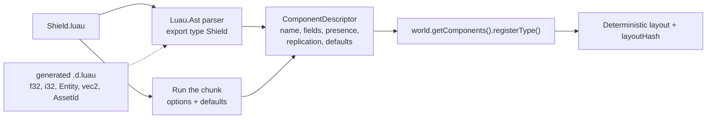

# 19 · Luau Bridge (v2)

## What it is

The bridge is the layer that lets **Luau scripts declare and run game code on the ECS**: components
(as Luau types), systems (as Luau classes), plugins, events, resources, input actions and
entities; capsules (actors and levels) are files, which scripts spawn through engine calls. It sits between Charles's `aylo-luau` runtime and the ECS's type-erased API, in the engine's
`ScriptPlugin` / `LuauPlugin`.

This doc is the **contract** the ECS offers; the binding code itself belongs to the scripting side
(Charles).

## Why we need it

- **R2:** games are written in Luau first. Everything a C++ plugin can register, a Luau plugin must be
  able to register too.
- **R3:** script components must replicate exactly like C++ ones, so they need a real layout, not
  arbitrary Luau tables.

## How others do it

| Engine | Scripting model |
|---|---|
| Bevy | No official scripting; community crates (`bevy_mod_scripting`) expose reflected components to Lua/Rhai |
| flecs | flecs script (its own language) declares components, entities, prefabs; bindings for many languages |
| Unity | C# `MonoBehaviour` (object model), or DOTS `ISystem` in C# |
| Unreal | Blueprint: classes and structs created in the editor, reflected like C++ ones |
| Roblox | Luau scripts on an object tree (not an ECS) |

## Our choice

- **Components = Luau types**, read from the source with the Luau parser, so they get a fixed binary
  layout.
- **Systems = Luau classes** with declared access.
- **Plugins = Luau modules** with a `build(app)` method.
- Everything goes through the ECS's **type-erased, non-throwing API**; errors come back to Luau through
  `aylo::luau::Result` / `Error`.

## How it works

### Components from types

```luau
-- Shield.luau
export type Shield = {
    strength: f32,
    regen: f32,
    owner: Entity,
}

return ecs.component("game.Shield", {
    replication = "everyChange",          -- or "spawnOnly"; omitted = never sent
    defaults = { strength = 50, regen = 2 },
})
```



- Luau erases types at runtime and has a single `number` type, so the bridge **parses** the file with
  `Luau.Ast` (the parser the compiler already uses, not the full type checker) and maps annotations to
  [`FieldType`s](02-component-registry.md).
- The aliases `f32`, `i32`, `u8`, `Entity`, `vec2`, `AssetId`... are declared in the `.d.luau` file
  produced by Charles's `Runtime::generateTypes()` (`type f32 = number`), so editors accept them.
- **Automatic type linking:** when the file exports exactly one type, or one type whose name matches
  the last part of the component name (`Shield` for `game.Shield`), the bridge links them without a
  `type = "Shield"` option.
- **Fallback** if annotation parsing is not possible: typed defaults (`strength = ecs.f32(50)`).

### Generated declarations for script components

`generateTypes()` is extended to emit declarations for **script-defined** components, resources,
events and capsules, after loading the plugins:

```luau
-- generated: game.d.luau
declare class ShieldComponent
    strength: number
    regen: number
    owner: Entity
end

type ComponentName = "aylo.Transform2D" | "aylo.SpriteRenderer" | "game.Shield" | "game.Health"
type CapsulePath = "actors/bydo.actor" | "scenes/level1.scene"
```

Editors then autocomplete component fields, and the type checker flags a typo like
`"game.Sheild"` in a query or a capsule path before the game runs.

### Systems

```luau
local ShieldRegen = ecs.system("game.ShieldRegen", {
    phase = "FixedUpdate",             -- default
    side = "server",                   -- default; see the side rule
    query = { write = { "game.Shield" }, without = { "aylo.Dead" } },
    after = { "aylo.movement" },
})

function ShieldRegen:run(ctx)
    for entity, shield in ctx.query do
        shield.strength = math.min(shield.strength + shield.regen * ctx.time.fixedDelta, 100)
    end
end

return ShieldRegen
```

The bridge turns the declaration into a `QueryList` of [dynamic queries](07-queries.md) and adds a
system made from a [`ScriptCallable`](12-systems.md#script-callables): a lambda capturing a handle to `run`,
whose `DynamicQueries` parameter declares the access to the scheduler. `shield` is a **view** over the component bytes, valid only
during `run`; writing a field stamps the changed tick.

`ctx.views` steps the same pass (`QueryStepper::nextNamed`, `system/SystemRun.cpp`), and gives the entity and one
table holding the views by the component's name (`it["game.Ship"]`) and by its short key, the name after the last `.`
with a lower-case first letter (`it.ship`). The table is made at the first step and refilled in place on every step,
through `luau::Pusher::setInTable()`, so a step makes no table. A short key two terms share is left out; its
metatable's `__index` answers `nil` for an optional view the entity lacks, and an error naming the keys to use or the
keys there are otherwise, and its `__newindex` refuses a new key. A tag the entity has is a view with no fields in both
iterators (`QueryMatch::has()`), and `nil` only when an optional one is missing.

`ctx:get(entity, name)` gives a view of a component of any other entity (`nil` when it is dead or lacks it) and
`ctx:has(entity, name)` tests it, through a `DynamicComponents` parameter: the component is declared with
`components = { read, write }`, or discovered at its first use, read, then written at the first write to a field of
its view, which marks it changed (`system/EntityComponents.hpp`). `aylo.Parent` and `aylo.Children` stay read-only
there, as in a query.
`ctx:getParent(entity)` and `ctx:getChildren(entity)` walk the hierarchy through the same parameter: they read
`aylo.Parent` and `aylo.Children` (discovered, read) with the typed `DynamicComponents::get<T>()`, and give an entity
or `nil`, and a new list of entities (a copy, which outlives the run). Before the world registers the hierarchy (at the
first parent), they give `nil` and an empty list.

### Engine calls

What a plugin does through a C++ API rather than through plain data (load an atlas, bind an input action, play a
sound) is an [engine call](12-systems.md#engine-calls): a named C++ function registered with `App::addCall()`.
Scripts make it by name, with a table of argument fields converted as component fields are (an `assetId` takes a
path):

```luau
local total = engine.call("game.addPoints", { points = 3 })   -- while the script loads

engine.ecs.system("game.Scorer", {
    query = { read = { "game.Ship" } },
    calls = { "game.addPoints" },                              -- optional, like resources and events
    run = function(ctx)
        for entity, ship in ctx.query do
            ctx.call("game.addPoints", { points = 1 })
        end
    end,
})
```

Missing argument fields keep their defaults. A result of one field is returned as that value, a result of several as
a table, and a call that returns nothing returns no value. A `std::string` field of a call takes and gives a Luau
string of any length, and a `std::vector` field a Luau array; an `ecs::String` field is cut at 255 bytes. The
arguments and the result live in `CallBuffer`s for the time of the call, so their memory is freed after it. A system's calls add their access to its own, so
the scheduler sees what they read and write, and runs it on the main thread when one of them needs it. A call the
system did not list is found the first time it is made (`DynamicCalls::add()`), as are resources and events
(see [Access found while running](13-scheduler.md#access-found-while-running)): listing is optional, and gives the errors
when the script loads. A name the system lists keeps the use it listed (a resource under `read` stays read-only, an
event under `read` cannot be sent); one it found gets the use it makes (a resource becomes written at the first write
of a field of its view). An unknown call, a wrong argument or a call that throws raises an error naming the call. An
unknown call in `calls` is refused when the script loads, unless the system does not run in that `App`'s mode: a client
system may list a call only the client plugins register.

The engine's plugins register these calls, on the side they are added on (the backend plugin and the plugins it
adds run on clients):

| Plugin | Calls |
|---|---|
| App (every `App`, both sides) | `aylo.state.get`, `aylo.state.set` ([States](13-scheduler.md#states-v2)) |
| Sprite | `aylo.sprite.loadAtlas`, `aylo.sprite.createAtlas`, `aylo.sprite.addFrame`, `aylo.sprite.addAnimation` ([Sprites](../../Sprites.md#from-scripts)) |
| Backend | `aylo.backend.loadTexture` |
| Text | `aylo.text.loadFont` ([Text](../../Text.md#from-scripts)) |
| Tilemap | `aylo.tilemap.load`, `aylo.tilemap.spawn` ([Tilemaps](../../Tilemap.md#from-scripts)) |
| Particle | `aylo.particle.beginEffect`, `aylo.particle.addBurst`, `aylo.particle.addColorKey`, `aylo.particle.addCurveKey`, `aylo.particle.addEffect` (clients) ([Particles](../../particles/design.md#12-luau)) |
| Http | `aylo.http.request`, `aylo.http.cancel` ([HTTP](../../Http.md#from-scripts)) |
| Json | `aylo.json.encode`, `aylo.json.decode` ([JSON](../../Json.md#from-scripts)) |
| Audio | `aylo.audio.loadSound`, `aylo.audio.soundInfo`, `aylo.audio.playSound`, `aylo.audio.playSound3D`, `aylo.audio.setListener3D`, `aylo.audio.getOutputLatency` ([Audio](../../audio/design.md#from-scripts)) |
| Input | `aylo.input.addAction`, `aylo.input.bind`, `aylo.input.bindAxis`, `aylo.input.bindVector`, `aylo.input.read` ([Input](../../Input.md#from-scripts)) |
| Physics | `aylo.physics.raycast`, `aylo.physics.shapeCast`, `aylo.physics.overlap`, `aylo.physics.moveAndSlide`, `aylo.physics.applyForce`, `aylo.physics.applyImpulse`, `aylo.physics.applyTorque`, `aylo.physics.setGravity`, `aylo.physics.raycast3D`, `aylo.physics.applyForce3D`, `aylo.physics.applyImpulse3D`, `aylo.physics.applyTorque3D`, `aylo.physics.setGravity3D`, `aylo.physics.shapeCast3D`, `aylo.physics.overlap3D`, `aylo.physics.moveAndSlide3D` ([Physics](../../physics/design.md#from-scripts)) |
| Capsule | `aylo.capsule.spawn`, `aylo.capsule.load`, `aylo.capsule.reload` ([Capsules](18-capsules.md#from-scripts)) |
| Replication | `aylo.replication.addInput`, `aylo.replication.readInput`, `aylo.replication.localClient` (clients) ([Replication](20-replication.md)) |

### Setup forms

The setup every game writes (its assets and its input actions) has declarative forms under `engine.assets` and
`engine.input`, which make those calls from one table. Each plugin brings its own forms, in Luau
([`Plugins.md`](../../Plugins.md#setup-forms)):

```luau
local ship = engine.assets.atlas({
    name = "game.ship", texture = "assets/ship.png", linear = false,
    grid = { frameSize = { x = 48, y = 48 }, count = 5, spacing = { x = 17, y = 0 } },
    animations = { fly = { frames = { 0, 1, 2, 3, 4 }, frameDuration = 0.08, direction = "pingPong" } },
})
local laser = engine.assets.atlas({
    texture = "assets/laser.png",
    frames = { { name = "shot", position = { x = 108, y = 151 }, size = { x = 80, y = 16 } } },
})
local explosion = engine.assets.atlas({
    path = "assets/explosion.json", animations = { boom = { first = 0, plays = 1 } },
})
local planet = engine.assets.texture("assets/planet.png", { linear = true, wrap = true })
local shot = engine.assets.sound("assets/shot.ogg", { stream = false })
local font = engine.assets.font("assets/fonts/main.json")
local level = engine.assets.tilemap("assets/level.tmj")

engine.input.action("move", "vector2", {
    bind = { { up = "W", down = "S", left = "A", right = "D" }, { x = "GamepadLeftX", y = "GamepadLeftY" } },
})
engine.input.action("steer", "axis", {
    bind = { { negative = "Left", positive = "Right" }, { control = "GamepadLeftX", scale = 1 } },
})
engine.input.action("fire", "button", { bind = { "Space", "GamepadSouth" } })
```

| Form | Calls | Returns |
|---|---|---|
| `engine.assets.texture(path, {linear, wrap})` | `aylo.backend.loadTexture` | the texture's `AssetId` |
| `engine.assets.sound(path, {stream})` | `aylo.audio.loadSound` | the sound's `AssetId` |
| `engine.assets.shader(path)` | `aylo.shader.load` | the shader's `AssetId` |
| `engine.assets.material({name, shader, values, textures})` | `aylo.shader.addMaterial`, then `aylo.shader.setMaterialValue` and `aylo.shader.setMaterialTexture` | the material's `AssetId` |
| `engine.assets.material(path)` | `aylo.shader.loadMaterial` (a `.material` file) | the material's `AssetId` |
| `engine.screenEffects(materials)` | `aylo.shader.setScreenMaterials` (clients; nothing on a server) | nothing |
| `engine.assets.font(path)` | `aylo.text.loadFont` | the font's `AssetId` |
| `engine.assets.tilemap(path)` | `aylo.tilemap.load` | the map's `AssetId` |
| `engine.assets.atlas{path \| texture, name, linear, grid, frames, animations}` | `aylo.sprite.loadAtlas` (a `path`) or `aylo.sprite.createAtlas` (a `texture`, named after it unless `name` is given), then `aylo.sprite.addFrame` per frame and `aylo.sprite.addAnimation` per animation, by name | the atlas's `AssetId` |
| `engine.assets.particle({name, ...})` | `aylo.particle.beginEffect` (every key but the lists), then `aylo.particle.addBurst` per burst, `aylo.particle.addColorKey` per `colorOverLife` key and `aylo.particle.addCurveKey` per `sizeOverLife` and `speedOverLife` key, then `aylo.particle.addEffect` | the effect's `AssetId` |
| `engine.http.request(ctx, {url, method, headers, body, timeout})` | `aylo.http.request` (with `ctx.call`, or `engine.call` when `ctx` is nil), `headers` written as `Name: value` lines sorted by name | the request's id |
| `engine.json.encode(value)`, `decode(text)`, `tryDecode(text)`, `map(entries)` | `aylo.json.encode` / `aylo.json.decode` (with `engine.call`; no `ctx` needed, the calls take no system resource), a value or a parsed text flattened into a node stream ([JSON](../../Json.md#from-scripts)) | the text, the value, the value or `nil` and a message, `entries` (the `{ key, value }` list) marked as an ordered object |
| `engine.input.action(name, type, {bind})` | `aylo.input.addAction` (`type`: `"button"` by default, `"axis"` or `"vector2"`), then one bind call per binding, in order | nothing |
| `engine.capsule.spawn(ctx, path, overrides)`, `engine.capsule.load(ctx, path, overrides)` (in a system) | `aylo.capsule.spawn` / `load` through `ctx.call`, then `ctx.commands:patch` of the root per override | the root `Entity` |
| `engine.capsule.reload(ctx, root)` (in a system) | `aylo.capsule.reload` through `ctx.call` | `true` if `root` was a capsule's root |
| `engine.input.read(ctx, action)` / `engine.input.read(ctx, entity, action)` (in a system; `InputForms.luau`) | `aylo.input.read` / `aylo.replication.readInput` (an `Entity` second picks it) | the action's state |
| `engine.state.get(ctx, machine)`, `engine.state.set(ctx, machine, value)` (in a system; `FormsPrelude.luau`, since states are the ECS's) | `aylo.state.get` / `aylo.state.set` | the value / nothing |
| `engine.audio.play(ctx, sound, options)` (in a system; `AudioForms.luau`) | `aylo.audio.playSound` | the voice id |
| `engine.net.localClient(ctx)` (in a system; `NetForms.luau`) | `aylo.replication.localClient` | `{ connected, client }` |

Every form that takes a `ctx` reads it with `forms.context(form, value)`: a table with a raw `call` function is a ctx;
anything else goes to `forms.contextOf`, which the Behaviour prelude sets to give the ctx of a `self` (or of a handle),
so a form takes a Behaviour's `self` in place of `ctx` (D9). `forms.callIn(form, ctx, name, fields)` makes the call
through it, its errors prefixed with the form.

- An atlas's `grid` takes `frameSize` and `count` (both needed), `spacing`, `columns` and `offset`; a frame takes a
  `position` and a `size`, and an optional `name` (its index otherwise) and `origin` (its centre otherwise). `grid`,
  `frames` and `name` make an atlas from a `texture`, not from a `path`.
- An animation's `frames` lists frame indices (from 0, as `aylo.sprite.addFrame` returns them) that follow each other,
  `{0, 1, 2}`, since an animation is a range of frames; `first` and `count` say the same (`count` 0 or absent: up to the
  last frame). It also takes `frameDuration`, `direction` and `plays` (0: forever).
- A binding is a control name (`aylo.input.bind`), `{control, scale}` (`aylo.input.bind` with a scale),
  `{negative, positive}` (`aylo.input.bindAxis`), `{up, down, left, right}` or `{x, y}` (`aylo.input.bindVector`).

A form checks its whole table on every side: an unknown key, a value of the wrong type or a binding of no known shape
is a Luau error naming the form and the part of it (`engine.assets.atlas: frame 2: 'size': missing 'y'`). Then, when
the App does not have its calls (the plugin is not in this process: on a dedicated server, the backend plugin and the
plugins it adds are not), it skips them and returns the id the asset would have, the hash of its path or name, so the
same script loads on the server and the clients. What only a plugin knows, such as a control name or an animation
direction, is checked where the plugin runs, and a call's error is prefixed with the form's name.

### Types

`ScriptHost::generateTypes()` (`types/TypeDefinitions.hpp`) writes a luau-lsp definition file, after the fixed start of `types/TypesPrelude.d.luau` (embedded), from what the App knows
at run time: the classes `Entity` and `AssetId`, one table type per component (`C_<name>`), event (`E_<name>`) and call
result (`R_<name>`), the fields in layout order with the Luau type a script reads (an enum's names as a union of
literals, a `vec3` as `vector`), `ctx:get`, `getComponent`, `ctx.events.read` / `send` and `ctx.call` as intersections
of one overload per name (a string literal), the overload of any name last since Luau takes the first that fits, and
`declare engine` walked from the live `engine` table, each function typed by what its owner described with
`engine.forms.describe(path, signature)` (`engine.forms.signatures`): the forms prelude describes the host's functions
(`engine.call`, `engine.ecs.*`), each plugin's forms file its own forms, and a call result a signature names but this
side lacks (`R_<call>`) is emitted as `any`. A function nobody described would be `(...any) -> ...any`; a test keeps
there being none. A Behaviour's `self` is a table type with its hooks as properties, so a method written on it
is checked with `self: Self`. The `Engine` writes it to `<game>/types/aylo.d.luau` at the end of a build and after a
hot reload that changed something, when it follows the game's files and the text differs (`Engine::writeScriptTypes`).

### Events

`engine.ecs.event(name, { fields })` (`ScriptHost::declareEvent`) reads its table with
`component::readEventDeclaration` (only `fields`, with the field types of components) and lays it out as a component of
the same fields (`component::registerEvent`), registered with `Events::registerType(EventInfo)`: never replicated,
sent from zeros with the fields the sender writes, read and sent through `ctx.events` like a C++ event, its access
declared or discovered. A reload that changes its layout, or no longer declares it, needs a rebuild, as for a
component (`FileDeclarations::events`).

### Behaviours

`engine.behaviour(name, { fields, defaults, replication, presence, side })` (`scripting/behaviour/BehaviourPrelude.luau`,
run after the forms prelude) is sugar over the two declarations above, with no concept of its own
(`docs/scripting/dx-plan.md`, D1 and D2). It declares the component `name` and returns a table whose `__newindex`
turns each hook assigned to it into a system: `onUpdate` (`Update`, `dt = ctx.delta`) and `onFixedUpdate`
(`FixedUpdate`, `ctx.fixedDelta`) are `<name>.<hook>`, querying `name` (written, or read on a client side when the
component is replicated). `onStart` declares the tag `<name>.Started` (not replicated, present on the hooks' side) and
the system `<name>.onStart` in `PreUpdate`, querying `name` without the tag: it adds the tag, then calls the hook. While
a Behaviour has `onStart`, the other hook systems skip an entity until `ctx:has` finds the tag, so the order holds
whichever phase spawned the entity, and a reload starts nothing again since the tag is in the world.

`onEnable` and `onDisable` declare both their systems and the tag `<name>.Active`: `<name>.onEnable` queries `name`
without the tag (the implicit enabled filter keeps the switched-on entities) and adds it; `<name>.onDisable` queries
`name` with the tag, names `aylo.Disabled` (so the filter is off) and takes the tag from what `ctx:isEnabled` finds
switched off. The three `PreUpdate` systems are ordered `onDisable`, `onEnable`, `onStart`, by `after` / `before` on
whichever is declared second. `<name>.onDestroy` (`PostUpdate`) queries `removed = { name }` (and names
`aylo.Disabled`); it takes the tags away, so it is declared with the first tag even without the hook, and calls the hook
with a `self` that has no view: its fields raise an error. `ctx:isEnabled(entity)` (`system/EntityComponents.hpp`)
walks `aylo.Parent` up to `ecs::detail::kMaxHierarchyDepth`, as the enabled filter does.

The `ScriptingPlugin` requires every `.luau` file of `scripts/behaviours/` (`FileSource::list`, so a pack too; sorted,
at any depth) after the `main` entry and before `server` / `client`, and warns about one that declared no Behaviour:
the prelude takes `engine.noteBehaviour` out of `engine` before any game script runs and calls it from
`engine.behaviour`, so the host records the Behaviours of each file (`ScriptHost::declaresBehaviour`). A reload runs a
new file of that folder as a root (`ScriptHost::setAdoptedFolder`), though the plugin turns adoption off elsewhere.

Each visit builds a `self`, a table whose metatable maps the declared fields to the query's view, `entity` and `ctx` to
the visit, and the methods (`getComponent`, `hasComponent`, `getParent`, `getChildren`, `getHandle`, `addComponent`,
`removeComponent`, `destroy`) to `ctx:get`, `ctx:has`, `ctx:getParent`, `ctx:getChildren` and `ctx.commands`; other
entities are handles with the same methods and no fields. Writing an undeclared field (D3) or a `ComponentView` (D5) is
an error. A name starting with `on` and a capital letter must be a hook; a field cannot take the name of a method.

### Plugins

```luau
local GamePlugin = ecs.plugin("aylo.Game")

function GamePlugin:build(app)
    app:load("components/Shield.luau")       -- by path: no require() across files
    app:load("systems/ShieldRegen.luau")
    app:addPlugin("scripts/aylo/weapons/plugin.luau")
    app:state("game.Phase", { "Menu", "Lobby", "Playing", "GameOver" })
    app:event("game.BossDefeated", { type = "BossDefeated" })
    app:resource("game.Score", { type = "Score", replication = "everyChange" })
end

return GamePlugin
```

This section is the original proposal. Today files `require` each other (by string path, `docs/scripting/plan.md`
D10, `docs/luau/modules.md`) and the `app:load` form above does not exist; only the entry points named in `project.luau`
(`scripts.main/server/client`) run by themselves, and each file has its own sandboxed globals (epic #489).

### Input actions from Luau

Gameplay reads `PlayerInput`, which is filled from Ethan's named `InputAction`s. A script declares those actions and
their default bindings with `engine.input.action` (see [Setup forms](#setup-forms)):

```luau
engine.input.action("move", "vector2", { bind = { { up = "W", down = "S", left = "A", right = "D" } } })
engine.input.action("fire", "button", { bind = { "Space", "GamepadSouth" } })
```

The form forwards them to `Input::addAction()` / `InputAction::bind...()` on clients, and, where the replication
plugin is added, declares them in the network `InputLayout` on both sides (`aylo.replication.addInput`), which the
manifest checks. On a client run by the `Engine`, a system (`aylo.engine.networkInput`) copies each of them from
`Input` into the `PlayerInput` sent to the server; a server script reads it by name with
`aylo.replication.readInput`:

```luau
engine.ecs.system("game.Ships", {
    phase = "FixedUpdate",
    query = { write = { "aylo.Transform2D" }, with = { "net.PlayerInput" } },
    calls = { "aylo.replication.readInput" },
    run = function(ctx)
        for ship, transform in ctx.query do
            local move = ctx.call("aylo.replication.readInput", { entity = ship, action = "move" }).vector
            transform.position = { x = transform.position.x + move.x * 4, y = transform.position.y - move.y * 4 }
        end
    end,
})
```

### Rules of the boundary

| Rule | Why |
|---|---|
| Scripts hold `Entity` values, resolved on every access | Pool pointers move (see [Pool](04-pool.md)); matches the proposal's *Handles* |
| Nothing throws into Luau | The type-erased API returns failures; the bridge raises a Luau error with an `ErrorKind` |
| Component views are only valid during `run` | Same reason as handles |
| Writes to read-only terms are refused | Keeps access sets truthful for the scheduler |
| `client` systems may not write replicated or server-only components, in their query terms, through `ctx:get` or through `ctx.commands` (checked when the side is set, at the first write of a `ctx:get` view and when a command is recorded; `both` systems are not checked) | Replication would overwrite anything else |
| Hot reload re-registers a component only if its `layoutHash` is unchanged | Existing data keeps its meaning |

### Where scripts run

Luau plugins load on the **server and the clients** (both need layouts, capsules and input actions).
System sides decide what runs where: `server` (gameplay, default), `client` (presentation), `both`
(identical simulation such as bullet motion). In standalone mode both sides run in one App.

A system is resolved only on the side it runs on (`registerSystem()`, #413). On the other side it becomes a
stand-in: its name, phase and side, with nothing it names resolved (components, resources, events, engine calls) and
no `after`/`before` of its own, since those may only exist on its side (the sprites, the audio, `net.applyInputs`). The
stand-in keeps the schedule's graph alike on both sides, so a system that runs there can still be ordered after or
before it. A file may therefore declare systems of either side and load everywhere, with no test of
`engine.isClient`:

```luau
engine.ecs.component("game.Explosion", { fields = {}, presence = "clientOnly" }) -- on both sides
engine.ecs.system("game.RemoveExplosions", { side = "client", ... })              -- resolved on clients only
```

What a system declares is still checked where it runs: an unknown name there is an error. Components and input
actions are still declared on both sides (the manifest compares them).

## Connections

- Uses: [Component registry](02-component-registry.md), [Queries](07-queries.md),
  [Systems](12-systems.md), [Commands](09-commands.md), [Events](11-events.md),
  [Resources](10-resources.md), [Capsules](18-capsules.md), [Reflection](15-reflection-and-serialization.md),
  [App and plugins](14-app-and-plugins.md).
- External: Charles's `aylo::luau::Runtime`, `Result`, `Error`, `generateTypes()`; Ethan's `Input` /
  `InputAction`.

## Pitfalls

- **Per-entity overhead.** Each `run` crosses the C++/Luau boundary; iterating thousands of entities in
  Luau every tick (bullets) can be too slow. That is where a C++ game plugin takes over (collisions,
  bullet motion).
- **Table-per-entity temptation.** Storing arbitrary Luau tables on entities would bypass queries,
  replication and the data/logic split; not supported.
- **Layout drift.** Server and client running different script versions are caught by `layoutHash` at
  connection.

## Open questions

- Can the `luau` xmake package expose `Luau.Ast`? If not, use the typed-defaults fallback. (Charles)
- Exact list of aliases emitted by `generateTypes()`. (Charles + ECS)
- Hot reload in development: migrate component data by field name when the layout changes? (ECS)
