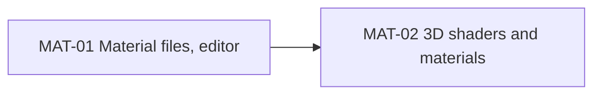

# Materials: files, the editor, and 3D

A material is a shader and the values of its `uniform`s and textures (`docs/Shaders.md`). Today it only exists in code:
a script declares it with `engine.assets.material({ shader = ..., values = ..., textures = ... })`, so nothing can open,
edit or save it, and the 3D models (`aylo.MeshRenderer`) take no material at all: they are drawn unlit by a fixed
pipeline. This plan makes a material a file of the assets, edited in the editor's Inspector as Unity edits one, and
gives the 3D models shaders and materials. It follows the 3D plan (`docs/3d/design.md`, epic #42).

## Decisions

| Question | Decision |
|---|---|
| Format | JSON, in a `.material` file of the assets |
| Who reads it | The shader plugin (`MaterialAssets::load(path)`), with nlohmann::json kept private to it, as the JSON plugin keeps its own copy; the editor writes it through a function of the shader plugin, so it includes no JSON library |
| From scripts | `engine.assets.material("materials/hit.material")` loads a file; the table form stays |
| Editing | In the Inspector: a `.material` clicked in the Assets shows its shader (drop a `.glsl` to change it), its uniforms with their types and defaults, its textures (drop an image); changes apply at once, **Save** (Ctrl+S) writes the file |
| Per entity | Unchanged: `instance uniform` values stay in the entity's `aylo.MaterialInstance`, edited in its Inspector |
| 3D shaders | A shader whose first lines hold `#pragma mesh` is a 3D shader, compiled for a new target `kMesh` only (as `#pragma screen` is for `kScreen`): unlit, `vertex()` and `fragment()` with `VERTEX` (vec3), `NORMAL`, `UV`, `COLOR`, `TEXTURE`, `TIME`. Lighting comes later, with the lights |
| 3D materials | `aylo.MeshRenderer.material`: a material whose shader is a 3D one; none, a wrong one or one not ready yet draws with the built-in unlit shader. A model's `instance uniform`s keep their defaults for now: the push constants of a mesh draw leave no room for them |
| raylib | It runs no game shader (they are compiled to SPIR-V), in 2D as in 3D: it keeps drawing models unlit and ignores their material |

## The file

```json
{
  "shader": "shaders/flash.glsl",
  "values": { "tint": [1.0, 0.2, 0.2, 1.0], "amount": 0.8 },
  "textures": { "noise": "textures/noise.png" }
}
```

`shader` is a path in the assets (or a built-in, `@aylo/...`); `values` gives a number or an array of 2 to 4 numbers
per uniform; `textures` an image path per `sampler2D`. What is missing keeps the shader's default. An unknown key, a
value of the wrong kind or a file that is not JSON fails the material with a message naming the file, and the drawings
keep the default material.

## Tasks

Each task is one pull request, stacked on the 3D stack (#54); the epic is #56.

| Id | Task | Blocked by |
|---|---|---|
| MAT-01 (#57) | Icons for shaders, materials and 3D models in the Assets panel; `.material` files (read, hot reload, `engine.assets.material(path)`, "New material" in the Assets); a material edited and saved in the Inspector | |
| MAT-02 (#58) | The 3D shader target (`#pragma mesh`, `kMesh`) in the shader plugin and Vulkan; `MeshRenderer.material` and its `MaterialInstance` | MAT-01 |



## Not in this plan

Lighting and lit materials, a shader graph, previews of a material on a sphere, materials on raylib.
