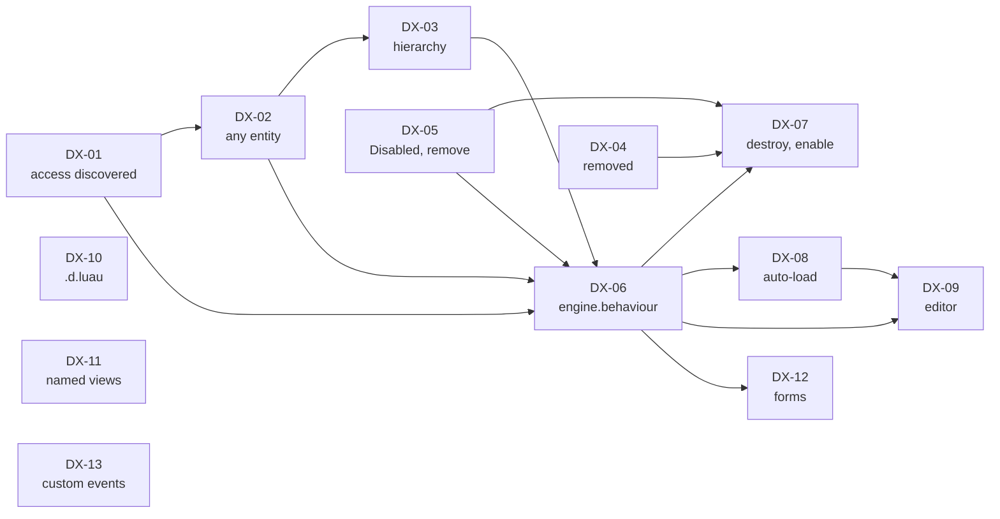

# Scripting DX for V1: plan

Goal: **writing a game in Luau is pleasant for a developer who does not know ECS**, without adding a second engine
model. Epic: #112.

Based on the code of 2026-11-25 (`main`, after the sky and IBL merge).

## 1. What hurts today

Read from `examples/games/` and the manual:

1. **Everything is declared, and helpers hide their needs.** `game.MoveShips` lists `aylo.capsule.spawn` in `calls`
   only because `Weapons.fire` calls it further down; a helper cannot know what its caller declared.
2. **Strings everywhere, no types.** `ctx.call("aylo.replication.readInput", { entity = entity, action = "move" }).vector`:
   no name is completed or checked before the game runs. No `.d.luau` is generated (`plan.md` puts it under "Later").
3. **Positional views.** `for entity, a, b in ctx.query` gives the views in the order read, write, optionalRead,
   optionalWrite; adding a `read` shifts every variable of the loop.
4. **A file no entry requires is silently ignored.**
5. **No link between a scene and the code.** The editor cannot attach behavior to a node; gameplay lives in systems
   that do not say which capsules they act on.
6. **Missing pieces.** No custom event declared from Luau, no `removed` detection (so no reaction to a component or an
   entity going away), no notion of a disabled entity, no way to read a component of another entity than the query's.
7. **The forms exist but are not the default.** `engine.physics.moveAndSlide` exists, yet the duel, `networking.md`
   and `systems.md` show `ctx.call`; the most common call of a networked game, `aylo.replication.readInput`, has no
   form.

## 2. Decisions

| # | Decision | Why |
|---|---|---|
| D1 | **Sugar, not a second layer.** Every DX feature is a way of writing, compiled to what the ECS already does, like `.scene` is a `.capsule`. Each one can be rewritten by hand as components and systems, and its manual page shows what it generates. What the ECS lacks is added for systems first, then the sugar uses it. | Keeps one model: replication, capsule saving, Play/Stop, hot reload and the scheduler keep working unchanged. |
| D2 | **A Behaviour is a component plus one generated system per hook.** Its fields are the component's fields (edited in the Inspector, saved in capsules); `onUpdate` becomes the system `<name>.onUpdate`, and so on. | D1. The names stay visible for `after`/`before`, errors, script limits and the editor panels. |
| D3 | **Only declared fields.** `self.cooldown = 3` on an undeclared field is an error. | Undeclared state would live outside the world: not replicated, not saved, not reset at Stop, lost on hot reload. |
| D4 | **Unity-style access, in camelCase.** `self:getComponent(name)`, `self:getParent()`, `self:getChildren()`, `self.entity`; other entities are handles with the same methods. A field cannot be named like a method. | Familiar, explicit (no guessed `self.transform`), and typeable with string-literal overloads in a `.d.luau`. |
| D5 | **A view never outlives its hook.** Storing one in `self` is an error saying to call `getComponent` in each hook; storing an entity is fine. Structural changes (`addComponent`, `destroy`, `setParent`) are deferred commands. | An ECS view is valid only during the call. Documented as the main trap for Unity users. |
| D6 | **One `side` for a whole Behaviour** (for now). | Simple first; a side per hook can come later. |
| D7 | **A Luau system's access is declared, or discovered at its first use.** It applies to engine calls, resources, events and components of other entities. Declaring stays possible and gives the errors at load. An ambiguity found while the game runs is a warning naming both systems, the data and the fix (`after`/`before`), never an error that stops the game. | The order of systems depends on `after`/`before` and the order they were added; their access only adds the server-before-client order of standalone, which the next build adds for what was found. The ambiguity check is a lint. Luau systems share one VM and never run in parallel with each other. It removes the boilerplate and the hidden needs of helpers (`Weapons.fire`) without a new helper API. |
| D8 | **The query terms stay declared.** | They say which entities a system visits, not only what it touches. |
| D9 | **Typed wrappers are forms.** No new mechanism: complete the system forms and make them what the examples and the manual show first; `ctx.call` is what is underneath. A form accepts a Behaviour's `self` in place of `ctx`. | One API for systems and Behaviours. |

D7 changes an invariant of `src/aylo/ecs/AGENTS.md` ("A system's accesses are declared by its parameters"): for Luau
systems, they are declared or discovered.

## 3. The Behaviour, as a script sees it

```luau
-- scripts/behaviours/Spinner.luau (made by right-click, New Behaviour, in the editor)
local Spinner = engine.behaviour("game.Spinner", {
	fields = { speed = "f32" },
	defaults = { speed = 90 },
	side = "client",
})

function Spinner:onStart() end

function Spinner:onUpdate(dt)
	local transform = self:getComponent("aylo.Transform2D")
	transform.rotation += self.speed * dt

	local parent = self:getParent()
	if parent then
		local health = parent:getComponent("game.Health")
	end
end

return Spinner
```

What it generates, by hand:

```luau
engine.ecs.component("game.Spinner", { fields = { speed = "f32" }, defaults = { speed = 90 } })
engine.ecs.system("game.Spinner.onUpdate", {
	phase = "Update",
	side = "client",
	query = { write = { "game.Spinner" } },
	run = function(ctx)
		for entity, spinner in ctx.query do
			-- calls Spinner.onUpdate with a self over (ctx, entity, spinner)
		end
	end,
})
```

A Behaviour costs one Luau call per entity and per hook: right for gameplay, not for ten thousand bullets, where a
system stays the tool. The manual says so.

## 4. Tasks

| Id | Issue | Task | Area | Blocked by |
|---|---|---|---|---|
| DX-01 | #123 | Access declared or discovered at first use (calls, resources, events) | Scripting, ECS | |
| DX-02 | #129 | Read and write a component of any entity from a system | Scripting | DX-01 |
| DX-03 | #130 | The hierarchy from scripts: parent and children of an entity | Scripting | DX-02 |
| DX-04 | #124 | `removed` in queries | ECS, Scripting | |
| DX-05 | #125 | `aylo.Disabled`: an entity the systems skip, and `ctx.commands:remove` | ECS, Scripting | |
| DX-06 | #131 | `engine.behaviour`: component, generated systems, `onStart`, `onUpdate`, `onFixedUpdate` | Scripting | DX-01, DX-02, DX-03, DX-05 |
| DX-07 | #132 | Behaviour hooks `onDestroy`, `onEnable`, `onDisable` | Scripting | DX-04, DX-05, DX-06 |
| DX-08 | #133 | Load `scripts/behaviours/` without a `require` | Scripting | DX-06 |
| DX-09 | #134 | Editor: New Behaviour, and Behaviours in Add component | Editor | DX-06, DX-08 |
| DX-10 | #126 | Generate a `.d.luau` for luau-lsp | Scripting | |
| DX-11 | #127 | Named query views | Scripting | |
| DX-12 | #135 | Complete the system forms and make them the default | Scripting, Docs | DX-06 |
| DX-13 | #128 | Custom events declared from Luau | Scripting, ECS | |

DX-10 does not wait for DX-06, but its overloads of `getComponent` come with it: the issue of whichever lands second
adds them.


